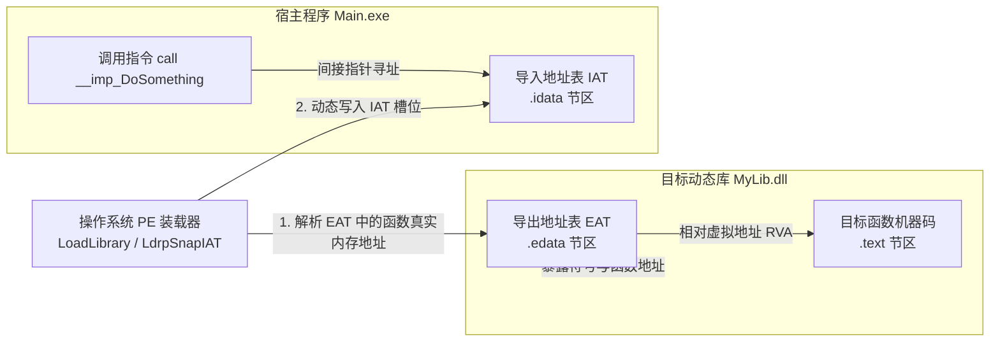
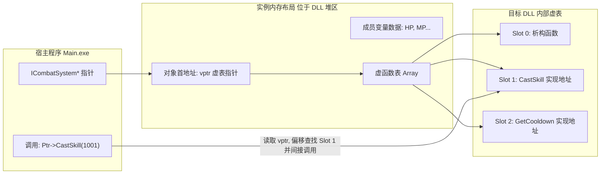
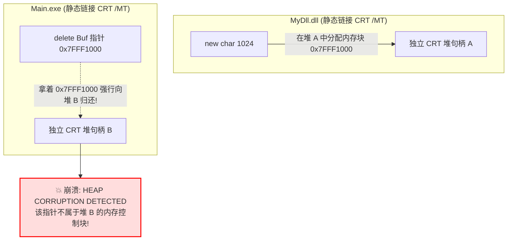

## 前言：从编译单元到动态链接的鸿沟

在现代大型工程（尤其是游戏引擎、大型 DCC 工具与微内核系统）的架构演进中，**动态链接库（Dynamic Link Library，Windows 下为 `.dll`，Linux 下为 `.so`）** 是实现模块解耦、插件化扩展、动态热更新与增量编译的核心纽带。

日常开发中，很多开发者可能熟练地写过：

```cpp
#ifdef MYLIB_EXPORTS
    #define MYLIB_API __declspec(dllexport)
#else
    #define MYLIB_API __declspec(dllimport)
#endif

MYLIB_API void DoSomething();
```

然而，一旦跨越动态库的边界，各种令人抓狂的诡异现象便层出不穷：
- **为什么在 DLL 里 `new` 了一个对象，在主程序里 `delete` 却发生堆崩溃（Heap Corruption）？**
- **为什么在 Debug 下编译的主程序调用 Release 编译的 DLL，一传 `std::string` 就直接崩在内存越界上？**
- **明明声明了单例模式（Singleton），为什么在不同的 DLL 里访问到的却是两个完全独立的实例？**
- **为什么 C++ 虚函数接口（Interface）可以跨 DLL 优雅调用，而导出一个带成员变量的普通类却步步惊心？**

要彻底驾驭动态链接库，我们必须穿透高级语法的表象，深入操作系统的可执行文件格式（PE/ELF）、编译器修饰机制（Name Mangling）、应用二进制接口（ABI）以及运行时堆（CRT Heap）的底层腹地。

今天这篇上篇，我们将系统拆解 **动态库的系统级物理构造、符号导出导入的汇编机理、ABI 兼容性模型以及跨模块内存的核心天坑**。

---

## 一、动态链接库的物理构造与加载流程

动态链接与静态链接最根本的区别在于：**静态链接（.lib / .a）在编译期把所有机器码直接烤入最终的可执行文件中；而动态链接（.dll / .so）将模块拆分为独立的二进制实体，直到程序运行时才进行符号的地址绑定。**

### 1. PE 文件中的核心结构

在 Windows 操作系统中，可执行文件（`.exe`）与动态库（`.dll`）遵循相同的 **PE（Portable Executable）** 格式规范。在动态链接中，有两个节区（Section）起着决定性作用：



1. **导出表（Export Address Table, EAT，位于 `.edata` 节区）：**  
   动态库向外界公开的“名片目录”。记录了该 DLL 导出的所有函数名、序号（Ordinal）以及该函数机器码相对于 DLL 模块基址的相对虚拟地址（RVA, Relative Virtual Address）；
2. **导入表与导入地址表（Import Address Table, IAT，位于 `.idata` 节区）：**  
   调用方（如 `.exe`）内部的一张函数指针数组。在编译期，调用方根本不知道目标函数在内存中的物理地址，因此在代码中留出一块占位槽（IAT Slot）。

---

### 2. 隐式加载 vs 显式加载

在操作系统层面，动态库的载入分为两种截然不同的方式：

| 加载机制 | 核心 API / 形式 | 依赖产物 | 绑定时机 | 优点与代价 |
| :--- | :--- | :--- | :--- | :--- |
| **隐式加载（Load-time Linking）** | 链接配套的 `.lib` 导入库 | `.dll` + `.lib` + 头文件 | 进程启动时由操作系统 PE 装载器自动加载 | 语法调用透明如本地函数；若缺少 DLL 进程直接报错无法启动 |
| **显式加载（Run-time Dynamic Linking）** | `LoadLibrary` / `GetProcAddress` / `FreeLibrary` | 仅需 `.dll` 二进制文件 | 运行时按需动态载入内存与卸载 | 极度灵活，可用于插件热插拔；但需手动转换函数指针，繁琐易错 |

> 💡 **Linux 对照：**
> 在 Linux / ELF 生态中，动态库表现为共享对象（Shared Object, `.so`）。
> - 导入/导出符号统一记录在 `.dynsym`（动态符号表）与 `.rela.dyn`（动态重定位表）中；
> - 显式加载对应的系统接口为 `dlopen()`、`dlsym()`、`dlclose()`。

---

## 二、符号导出导入的汇编级机理

很多开发者习惯性地把 `__declspec(dllexport)` 和 `__declspec(dllimport)` 视作玄学宏。但如果在反汇编器中观察，两者的底层指令行为有着本质的不同。

### 1. `__declspec(dllexport)` 的本质

当一个函数被标记为 `__declspec(dllexport)` 时，编译器会做两件事：
1. 生成该函数的常规机器码指令；
2. 在目标文件（`.obj`）中嵌入一条链接器指令（`.drectve` 节区）：
   `-export:?DoSomething@@YAXXZ`
3. 链接器（`link.exe`）收集所有 `-export` 指令，生成动态库的 `.edata` 导出表，同时生成配套的 **导入库（Import Library, `.lib`）**。

> ⚠️ **重要澄清：**
> 这里的 `.lib` 并不是包含目标机器码的静态库，它是一个“轻量级骨架库”，仅包含符号名称与对应 DLL 名字的桩信息（Stub），供链接器在编译可执行文件时核对符号并生成调用方 IAT。

---

### 2. `__declspec(dllimport)` 的汇编真相：跳板 vs 直接解引用

如果不加 `__declspec(dllimport)`，外部代码能否调用该 DLL 里的函数？
**答案是：可以编译链接通过，但会付出一次额外的间接跳转（Jmp Thunk）代价！**

来看底层的反汇编对比：


#### ① 不写 `__declspec(dllimport)` 时的汇编：
调用方以为 `DoSomething` 是一个本地函数，生成：
```asm
call DoSomething               ; 直接调用本地符号相对地址
```
链接器发现这个符号其实在导入库中，为了让代码能够运行，链接器偷偷在调用方可执行文件中塞进了一段**胶水跳板代码（Import Thunk）**：
```asm
DoSomething:
    jmp qword ptr [__imp_DoSomething]  ; 从 IAT 读取真实地址并跳转
```
**后果：** 每次函数调用多发生了一次无谓的 `jmp`，破坏了 CPU 的分支预测流水线。

#### ② 正确声明 `__declspec(dllimport)` 时的汇编：
编译器明确知道该符号来自外部 DLL，直接跳过辅助跳板，编译出高效的**直接间接寻址指令**：
```asm
call qword ptr [__imp_DoSomething]    ; 直接一步到位解引用 IAT 槽位！
```

---

## 三、C++ 跨 DLL 的头号大敌：Name Mangling 与 ABI 稳定

如果只用 C 语言写 DLL，动态链接非常平稳。但一旦进入 C++ 的领地，动态库的复杂度瞬间指数级飙升。

### 1. 为什么必须有 Name Mangling（名称修饰）？

C 语言中，函数名是全生命周期唯一的。
但在 C++ 中，为了支持**函数重载（Overload）、命名空间（Namespace）、类成员函数、模板特化（Template）**，编译器必须在编译期将可读的函数签名，重新编码成全局唯一的字符串符号：

```cpp
// 源码
namespace MyEngine {
    class FPlayer {
    public:
        int CalculateDamage(float Multiplier, bool bCritical);
    };
}
```

- **MSVC 编译器修饰为：** `?CalculateDamage@FPlayer@MyEngine@@QEAAHMN@Z`
- **GCC / Clang 编译器修饰为：** `_ZN8MyEngine7FPlayer15CalculateDamageEfb`

#### ABI 致命灾难：
如果主程序是用 MSVC 编译的，而 DLL 是用 GCC（MinGW）编译的，两者的修饰规则完全南辕北辙！主程序去 DLL 的导出表里按照 `?Calculate...` 检索，DLL 里面写的却是 `_ZN8...`，**符号匹配直接失败，抛出致命的 `LNK1120` 未解析外部符号错误！**

---

### 2. `extern "C"`：跨语言与跨编译器的万能通宝

为了消除不同编译器之间的修饰鸿沟，C++ 提供了 `extern "C"` 语言特性：

```cpp
extern "C" {
    MYLIB_API int CalculateDamage_C(float Multiplier, bool bCritical);
}
```

- **作用：** 强行命令 C++ 编译器关闭名称修饰逻辑，以最纯粹的 C 符号规则（`CalculateDamage_C`）导出；
- **代价：** 放弃重载、放弃命名空间、放弃类成员函数语法糖；
- **地位：** 所有跨语言交互（C# P/Invoke、Python ctypes、Rust FFI）以及跨编译器插件架构的唯一安全基础。

---

### 3. 虚函数表（VTable）跨 DLL 调用的奇迹

既然 C++ 类导出充满危险，为什么现代游戏引擎（如虚幻引擎的模块接口、CryEngine 的插件系统）依然能优雅地跨 DLL 调用 C++ 对象？

**核心秘诀在于：基于纯虚接口类（Pure Abstract Interface / COM 风格）的多态调用！**

```cpp
// Interface.h (主程序与 DLL 共享的头文件)
class ICombatSystem
{
public:
    virtual ~ICombatSystem() = default;
    virtual void CastSkill(int32 SkillID) = 0;
    virtual float GetCooldown() const = 0;
};

// 导出纯 C 工厂函数
extern "C" MYLIB_API ICombatSystem* CreateCombatSystem();
extern "C" MYLIB_API void DestroyCombatSystem(ICombatSystem* Instance);
```



#### 为什么纯虚接口可以免疫 Name Mangling 和跨模块重新编译？
1. **统一内存布局契约：**  
   各大主流 C++ 编译器（MSVC、Clang、GCC）在 x64 架构下，对于没有多继承的纯虚类，对象内存排布达成了事实上的工业标准：**对象首部必定是一个 8 字节的 `vptr` 指针，指向连续的虚函数指针数组（VTable）**；
2. **汇编级间接调用：**  
   主程序调用 `Ptr->CastSkill(1001)` 时，生成的汇编代码是：
   ```asm
   mov rax, qword ptr [rcx]     ; 读取 vptr
   call qword ptr [rax + 8]     ; 调用虚表中的第 2 个槽位 (Slot 1)
   ```
   主程序在编译期根本不需要链接 `CastSkill` 的符号名称！它只需要知道该函数在虚表中的**固定槽位偏移（Offset）**即可完成精确调用！

---

## 四、3A 级开发最高危雷区：跨模块内存与状态天坑

如果说符号和 ABI 只是编译期的门槛，那么跨模块内存管理则是会在运行时直接引发灾难性系统崩溃的“深水炸弹”。

---

### 1. 致命天坑之一：跨 CRT 堆边界（CRT Heap Boundary）崩溃

这是绝大多数 C++ 开发者都会踩入的顶级深渊：

```cpp
// ❌ 灾难代码：跨模块分配与释放
// MyDll.dll 内部
MYLIB_API char* AllocateBuffer(size_t Size) {
    return new char[Size]; // 由 MyDll 的 CRT 堆分配
}

// Main.exe 内部
int main() {
    char* Buf = AllocateBuffer(1024);
    delete[] Buf; // 💥 瞬间崩溃！由 Main.exe 的 CRT 堆释放！
}
```

#### 崩溃真相：CRT 堆隔离机理
在 Windows 平台上，如果可执行文件与动态库使用的是**静态链接 C 运行时库（`/MT` 或 `/MTd`）**：
- 每一个模块内部都静态嵌入了一套独立的 C 运行时环境（C Runtime Library, CRT）；
- 每个 CRT 会调用 Windows API `HeapCreate` 创建一个**专属于该模块的独立进程堆（Heap Handle）**；
- `MyDll.dll` 中的 `new`，实际上是在**堆 A** 中分配了内存；
- `Main.exe` 中的 `delete`，却拿着这块内存指针去**堆 B** 的元数据链表中进行校验和释放；
- **堆管理器发现该指针根本不在自己的分配记录中，立即抛出操作系统断言：**  
  `HEAP CORRUPTION DETECTED / Invalid Address specified to RtlFreeHeap`！



#### 工业级破解之道：
1. **全局统一动态链接 CRT（`/MD` 或 `/MDd`）：**  
   所有模块统一动态链接 `msvcp140.dll`，全进程共享同一个全局默认进程堆；
2. **“谁分配，谁释放”契约原则：**  
   在接口层配对暴露释放函数：
   ```cpp
   MYLIB_API char* AllocateBuffer(size_t Size);
   MYLIB_API void FreeBuffer(char* Buffer); // 必须回到 DLL 内部销毁！
   ```

---

### 2. 致命天坑之二：跨 DLL 传递 STL 标准库容器（STL Trap）

很多开发者喜欢写出这样的接口：
```cpp
// ❌ 极其危险的跨模块接口
MYLIB_API void QueryUserNames(std::vector<std::string>& OutNames);
```

#### 为什么千万不能在 DLL 接口中传 STL？
1. **编译配置不对齐（Debug vs Release）：**  
   - 在 MSVC Debug 模式下，`std::vector` 会开启安全迭代器校验（`_ITERATOR_DEBUG_LEVEL = 2`），其内部除了指针还带有额外的调试链表，对象尺寸比 Release 模式大了整整 16~24 字节；
   - 如果主程序是 Release，DLL 是 Debug，两者看待同一个 `std::vector` 对象的内存布局完全错位，访问成员即触发越界崩溃；
2. **短字符串优化（SSO, Small String Optimization）版本分歧：**  
   不同版本的标准库对于 `std::string` 的内联缓冲区大小定义不一致；
3. **隐式内存跨堆释放：**  
   当主程序把 `OutNames` 传进 DLL，DLL 内部调用 `OutNames.push_back("Alice")` 时，`std::string` 内部的字符数组是由 DLL 的堆分配的；一旦返回主程序并最终超出作用域析构，主程序又会试图释放该字符数组，再次触发上述的 CRT 堆崩溃！

> 🛡️ **黄金法则：**
> 动态库导出的公有接口（Public ABI），**参数必须退化为基础数据类型（POD）、纯 C 风格指针（`const char*`、`int32_t`）、或者固定内存布局的纯虚接口**！绝不允许直接传递 STL 容器！

---

### 3. 致命天坑之三：静态变量与单例的“多胞胎”现象

在现代 C++ 中，著名的 Meyers' Singleton（迈耶斯单例）以优雅著称：

```cpp
// Singleton.h (如果作为普通头文件被多个模块包含)
template<typename T>
class TSingleton {
public:
    static T& Get() {
        static T Instance; // 局部静态变量
        return Instance;
    }
};
```

#### 隐蔽恶果：
- 当 `Main.exe` 和 `PluginA.dll` 同时包含了 `Singleton.h`，并在各自的代码里调用 `TSingleton<FGameConfig>::Get()` 时；
- **编译器会在 `Main.exe` 的 `.data` 节区生成一个 `Instance`，又在 `PluginA.dll` 的 `.data` 节区生成一个全新的 `Instance`！**
- 结果：插件内部修改了配置，主程序完全感知不到；原本期望的全局单例，在内存中硬生生分裂成了两个互不相干的独立多胞胎！

#### 根治方法：
单例类的实例**必须被强行绑定到某一个核心 DLL 内部，并通过导出的静态方法对外分发**，绝对不能将模板静态变量直接写在共享头文件中由各模块自由展开。

---

## 五、全景速查对照表与架构总结

| 问题维度 | 底层根因 | 生产事故表现 | 工业级解决方案 |
| :--- | :--- | :--- | :--- |
| **符号链接失败** | C++ Name Mangling 在不同编译器下规则互异 | `LNK2019 / LNK1120` 无法解析外部符号 | 导出接口使用 `extern "C"` 规整符号 |
| **跨模块堆崩溃** | 各模块静态链接 CRT（`/MT`），各持独立堆句柄 | 释放时触发 `RtlFreeHeap` 内存非法断言 | 统一使用 `/MD` 动态链接 CRT，或实行“谁分配谁释放” |
| **STL 容器内存越界** | Debug/Release 宏开关导致对象内存布局大小不同 | 访问 `vector/string` 时内存偏移行距错乱崩溃 | 跨模块接口禁止传递 STL，改用纯虚接口或 POD 结构 |
| **单例状态分裂** | 模板静态变量在每个 DLL 中被各自独立实例化 | 全局单例在不同 DLL 呈现出不同的数据副本 | 核心模块集中持有单例，通过导出函数统一定址 |

---

## 结语与下篇引申

通过本篇对通用 C++ 与操作系统底层动态库机制的全面剖析，我们终于看透了动态链接这把“双刃剑”：
它带来了极致的模块化与动态能力，却在 **符号修饰、CRT 堆隔离、STL 传递与单例唯一性** 处处布满了杀机。

**面对这些棘手的工业级难题，虚幻引擎（Unreal Engine）交出了一份惊艳的答卷：**
- 虚幻是如何靠一套极简的 `MYPROJECT_API` 宏体系，自动化管理全引擎上百个模块的导入导出的？
- 虚幻是如何在全引擎上百个 DLL 之间，**安全、肆无忌惮地传递 `TArray` 和 `FString`，却从未发生过 CRT 堆崩溃的？**
- 虚幻全局核心单例（`GEngine`、`GMalloc`、`GUObjectArray`）是如何跨越几十个 DLL 保持绝对唯一的？
- 虚幻编辑器那项如同魔法般的 **Live Coding（热重载）**，底层又是如何在不重启游戏的前提下，给正在运行的 DLL 实施“偷梁换柱换头术”的？

敬请期待下篇——**《现代 C++ 与虚幻模块化底层：DLL 全景解密（下）：虚幻引擎模块架构、统一内存模型与 Live Coding 换头术》**！
