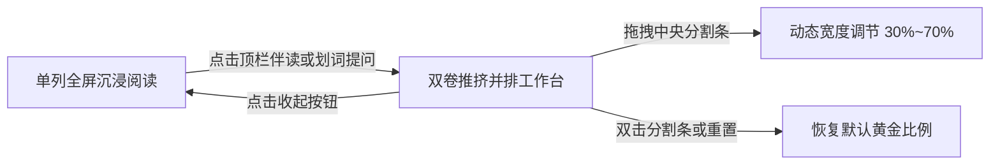
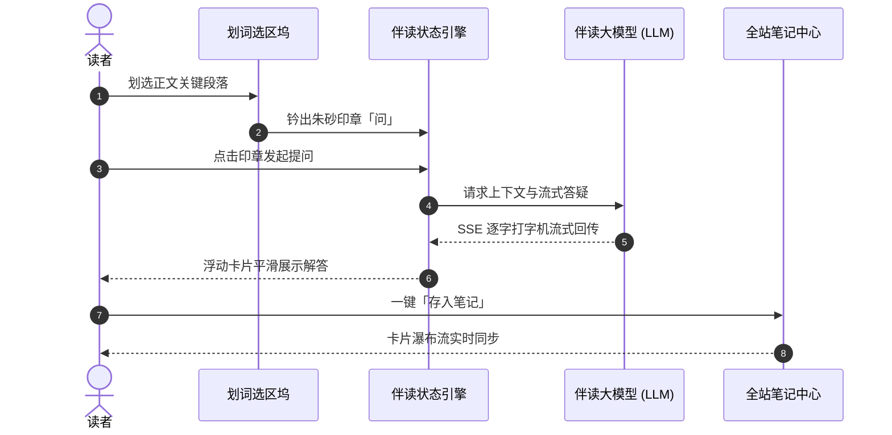

# 交互式阅读空间指南

在传统博客中，读者往往处于单向输入状态。而在「清浅」中，我们构建了一个**可互动、可并排、可探索**的立体阅读空间。

---

## 一、 双卷推挤并排工作台 (Companion Layout)

当你阅读一篇长篇架构分析或技术论文时，频繁切换标签页或弹窗遮挡正文往往会打断阅读心流。

### 1.1 并排分屏的诞生
在宽屏桌面端，点击顶栏的「**墨问 AI**」伴读按钮，工作台会以优雅的物理弹性动效向左推挤正文，让**文章卷**与**伴读/笔记卷**同屏并存：

### 1.2 拖拽调节与窗口聚焦
- **物理分界线**：中间的分隔条支持鼠标拖拽，实时平滑调整左右工作区比例。
- **独立滚动隔离**：两卷内部均配备自研的滚动隔离算法（`scrollIsolation`），在快速滑动一边时绝不发生滚动穿透或整页连锁抖动。

---

## 二、 Mermaid 流程图与高阶图表交互

博客原生深度集成了 Mermaid 图表渲染引擎，并在每张图表顶部配备了专属的交互工具坞：

### 2.1 图表专属工具栏功能
查看上方图表右上角的悬浮工具栏，你可以体验：
1. **无级滚轮缩放 (100% ~ 500%)**：点击 `+` / `-` 按钮，或按住鼠标滚轮进行微距图表缩放。
2. **源码 / 图表秒切**：点击 `Code` 查看原生 Mermaid 代码定义，点击 `Copy` 快速复制。
3. **分屏对照 (Pin)**：点击 `Pin` 按钮将图表钉到桌面工作台，一边向下滚屏一边对照核心拓扑。
4. **全屏沉浸预览 (Expand)**：全屏查看庞大纷繁的架构拓扑图。

---

## 三、 划词批注与笔记沉淀系统

在任意正文段落中选中一段文字：
1. 选区末尾会自动出现一枚朱砂印章「**问**」。
2. 点击印章，即可唤起水墨伴读对话框。
3. 选区下部同时会浮现「**划词停靠坞 (Selection Dock)**」，支持：
   - 🎨 **四色荧光墨晕**：给重点语句划线高亮。
   - ✍️ **批注评论**：添加读者思考与批语。
   - 📖 **摘录存入笔记**：直接转化为独立笔记便签，在 `/notes` 页面随时温故知新。

---

## 四、 键盘快捷键与高效导航

为了兼顾键盘党与无障碍体验，博客支持丰富的全局快捷键：
* `Esc`：快速关闭当前弹窗、全屏图表或侧边栏。
* `Shift + ?`：唤起全站快捷键与搜索面板。
* `Tab`：符合 WCAG AAA 级对比度的高亮键盘焦点环导航。

快去划选本文的任意句子，亲手试试这套流利的交互吧！
