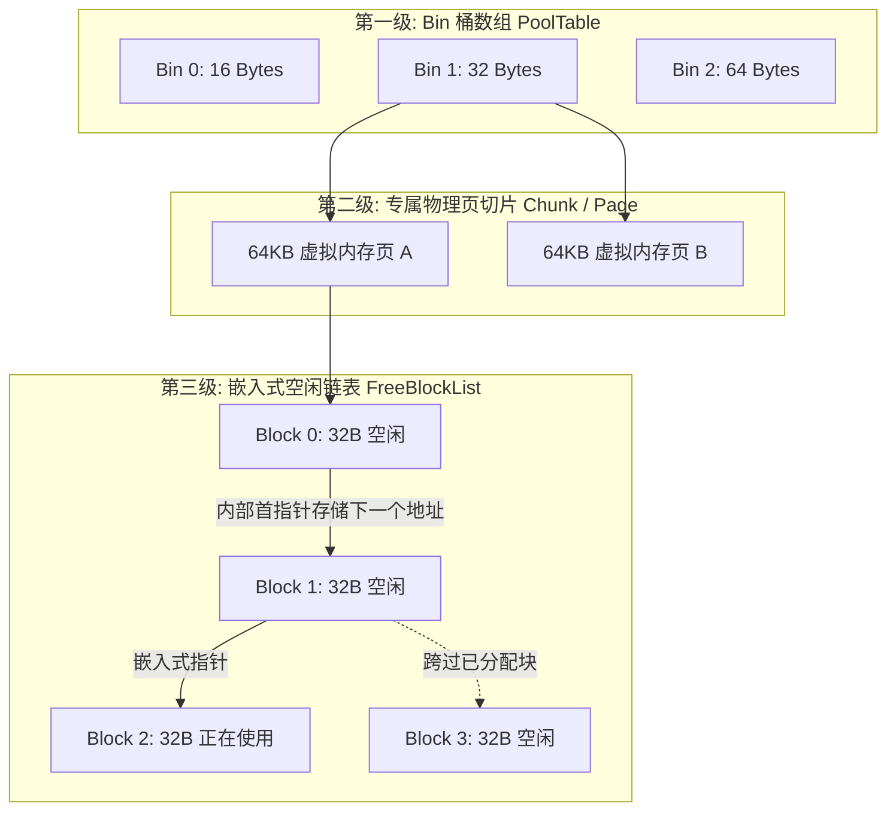

## 前言：超越 OS 默认堆的工业级诉求

在现代 3A 游戏引擎的底层工程中，内存管理直接决定了游戏运行时的帧率下限、平稳度以及硬件承载边界。

很多初学者常常会有疑问：“既然操作系统的标准 C++ 运行时库（CRT）已经提供了成熟的 `malloc` 和 `free`，为什么虚幻引擎还要大费周章地从零自研一套复杂的内存分配器体系？”

答案隐藏在 3A 工业级项目的残酷运行负载中：
1. **多线程全局锁竞争（Lock Contention）：** 在几十个并发工作线程（Worker Threads）高频分配小对象时，原生操作系统的默认堆（Heap）通常依赖全局临界区或互斥锁，导致严重的线程挂起与吞吐崩溃；
2. **外部内存碎片（External Fragmentation）：** 游戏长时间运行后，大量生命周期不一、尺寸从几个字节到几十兆字节交错申请的内存，会导致物理内存出现海量不可用的“微小空洞”，最终明明物理内存充足却因找不到连续页而触发 OOM（Out of Memory）灾难；
3. **高频系统调用损耗（Syscall Overhead）：** 频繁向操作系统内核申请与归还内存页，会导致大量用户态与内核态的上下文切换（Context Switch），极大地浪费 CPU 时钟周期。

为了破解这些痛点，虚幻引擎在操作系统之上构建了自底向上的精密内存治理大厦：

```mermaid title="虚幻引擎内存自底向上分层架构全景"
flowchart TD
    OS[操作系统内核: Windows / Linux / Console / Android] --> VM[虚拟内存物理页: VirtualAlloc / mmap]
    
    subgraph 平台底层硬件抽象层
        VM --> PM[FPlatformMemory 平台内存适配器]
    end

    subgraph 核心物理分配器层 (FMalloc 抽象接口)
        PM --> FMallocBinned[FMallocBinned2 / FMallocBinned3<br/>分桶内存分配器: 全平台主力核心]
        PM --> FMallocMimalloc[FMallocMimalloc<br/>高吞吐现代多线程分配器]
        PM --> FMallocStomp[FMallocStomp<br/>物理页越界保护诊断分配器]
        PM --> FMallocAnsi[FMallocAnsi<br/>标准 C 库回退分配器]
    end

    subgraph 引擎通用中间件与全局路由
        FMallocBinned --> GMalloc[全局统一分配器指针: GMalloc]
        FMallocMimalloc --> GMalloc
        FMallocStomp --> GMalloc
        FMallocAnsi --> GMalloc
        GMalloc --> OpNew[全局重载 operator new / delete]
    end

    subgraph 引擎容器与对象体系
        OpNew --> Containers[高性能容器生态: TArray / TMap / TSet]
        OpNew --> StringPool[全局字符串池: FNamePool]
        OpNew --> UObjectSystem[UObject 反射与垃圾回收体系]
    end
```

今天这篇上篇专题，我们将自底向上深入探索：**底层物理分配器 `FMallocBinned` 如何依靠分桶算法平抚碎片、容器特化分配策略（`TInlineAllocator`）如何将堆开销降为零，以及全局 `FNamePool` 是如何仅用 8 字节实现海量字符串秒级比较的。**

---

## 一、核心分配器全景与 FMalloc 抽象体系

在虚幻引擎中，所有物理内存的生杀大权，统一收拢于抽象基类 **`FMalloc`**。

### 1. FMalloc 的核心接口与职责

打开 `Engine/Source/Runtime/Core/Public/HAL/FMemory.h`，`FMalloc` 规定了所有具体分配器必须履行的四大核心契约：

```cpp
class CORE_API FMalloc : public FUseSystemMallocForNew
{
public:
    // 基础分配与重分配接口 (包含字节尺寸与对齐要求)
    virtual void* Malloc(SIZE_T Count, uint32 Alignment = DEFAULT_ALIGNMENT) = 0;
    virtual void* Realloc(void* Original, SIZE_T Count, uint32 Alignment = DEFAULT_ALIGNMENT) = 0;
    virtual void  Free(void* Original) = 0;

    // 内存自省与诊断接口 (常数时间内查询指针所占真实物理块尺寸)
    virtual bool  GetAllocationSize(void* Original, SIZE_T& SizeOut) = 0;

    // 状态统计与内存泄漏转储
    virtual void  DumpAllocations(class FOutputDevice& Ar) {}
    virtual bool  ValidateHeap() { return true; }
};
```

---

### 2. GMalloc 的生命周期：在万物之前苏醒

在[《模块化 DLL 架构与统一内存》](/posts/ue5-module-dll-and-hot-reload-deep-dive)中我们曾介绍过，虚幻重载了全局 `operator new`，使其全部指向全局单例指针 `GMalloc`：

```cpp
// 导出全局物理分配器指针
CORE_API FMalloc* GMalloc = nullptr;
```

#### 关键启动时序：
1. **引擎极早期阶段（`FEngineLoop::PreInitPreStartupScreen` 之前）：**  
   当操作系统刚把可执行文件载入内存时，虚幻会在执行任何 C++ 静态对象初始化之前，优先调用 `FPlatformMemory::BaseAllocator()` 实例化具体的分配器（如 `FMallocBinned2`），并将地址赋值给 `GMalloc`；
2. **不可篡改性：** 一旦 `GMalloc` 挂载完毕，直至游戏进程退出前，所有模块内的内存分配全部强制走这一条专线，彻底杜绝了不同 DLL 拥有不同 CRT 堆导致的释放崩溃。

---

### 3. 主流内置分配器横向选型矩阵

虚幻内置了多种各具特色的物理分配器，通过启动参数（如 `-malloc=binned2`）或平台配置文件按需选配：

| 分配器类名 | 适用平台与场景 | 核心算法与特征 | 工业级优势与代价 |
| :--- | :--- | :--- | :--- |
| **`FMallocBinned2`** | PC / 主机 / 移动端主力 | 分桶池化（Binned Pool）+ 64 位虚拟地址保留 | ✅ 极低碎片率，小对象常数时间分配；内存开销极平稳 |
| **`FMallocBinned3`** | 64 位大型服务器与主机 | 增强型分桶 + 线程本地缓存（TLS Cache） | ✅ 极致消除多核锁争用，高并发性能极其强悍；依赖大虚拟地址空间 |
| **`FMallocMimalloc`** | Windows / Linux 高性能场景 | 集成微软开源的 mimalloc 分配器（UE5 引入） | ✅ 吞吐量极高，大块内存分配与内存碎片处理表现优异 |
| **`FMallocStomp`** | **调试与开发期专属** | 物理页边界隔离（Guard Page）保护 | 🛡️ **内存踩踏与野指针定位神器**；极度耗费内存，禁止用于生产包 |
| **`FMallocAnsi`** | 特殊平台与极简环境 | 直通 C 运行时库 `malloc` / `free` | ⚠️ 性能与碎片控制较弱，仅用于回退调试 |

---

## 二、分桶内存分配器（FMallocBinned2/3）底层机理深度剖析

`FMallocBinned` 家族是虚幻引擎最引以为傲的工业级内存技术资产之一。它的核心思想可以用一句话概括：
**“大内存直通虚拟页，小内存分桶归一化。”**

```mermaid title="FMallocBinned 内存双轨分流决策拓扑"
flowchart TD
    Req[外部申请内存: Malloc Size] --> Check{申请尺寸 Size > 阈值 64KB?}
    
    subgraph 大对象直通分配路线 Large Allocations
        Check -- 是 --> LargeAlloc[直接调用 FPlatformMemory::VMAlloc<br/>向 OS 申请连续虚拟内存页]
        LargeAlloc --> RecHeader[在页首写入 OS 分配元数据信息头]
    end

    subgraph 小对象分桶归一化路线 Binned Allocations
        Check -- 否 --> CalcBin[查 SizeTable 表计算对应的 Bin 桶编号]
        CalcBin --> TLS{线程本地缓存 TLS 是否有可用 Block?}
        TLS -- 命中 --> FastPop[无锁从 FreeList 弹出 Block 0 锁竞争 $O(1)$]
        TLS -- 未命中 --> GlobalPool[锁定全局 PagePool 批量提取一组 Block]
        GlobalPool --> FastPop
    end
```

---

### 1. 为什么小对象必须“分桶（Binning）”？

在游戏运行期间，80% 以上的内存申请都是极小的尺寸（如 16 字节的 `UObject` 节点、24 字节的动态数组头部、48 字节的向量数学对象）。
如果让它们随意在连续内存中分配，当一个 16 字节的对象被释放，紧随其后的 24 字节对象没有释放时，就会在内存中留下一个永久无法安置大于 16 字节对象的“微观死区”。这种死区积累数万个之后，物理内存便支离破碎。

#### Binned 分配器的解法：尺寸归一
虚幻预设了一张严谨的 **尺寸级别表（Size Class Table）**：
- 申请 1 ~ 16 字节：一律分配 **16 字节** 的 Block；
- 申请 17 ~ 32 字节：一律分配 **32 字节** 的 Block；
- 申请 33 ~ 48 字节：一律分配 **48 字节** 的 Block；
- 依次类推，直到上万字节的预设分界线。

**收益：** 相同尺寸的内存块永远存放在专属的物理内存页内，回收时留下来的空位必定可以接纳下一个相同尺寸的申请者，**从数学上根除了不同尺寸穿插引发的外部碎片！**

---

### 2. Binned 分配器的三级物理拓扑



1. **第一级：Bin 桶表（PoolTable）：**  
   管理每种尺寸类别的全局管理者索引；
2. **第二级：内存页切片（Chunk / Page）：**  
   每次向操作系统申请一大块虚拟内存（如 64KB）。一旦这个 Page 被指派给 Bin 32，它内部就被整齐划一地“切豆腐块”切成 $65536 / 32 = 2048$ 个 32 字节的小 Block；
3. **第三级：嵌入式空闲链表（Intrusive FreeBlockList）：**  
   当一个 32 字节的 Block 未被分配时，虚幻**不会为它额外开辟链表节点内存**，而是极其巧妙地将未使用的前 8 个字节直接当做指针，指向下一个空闲 Block 的首地址！
   - 分配时：直接把链表头指针弹出，耗时仅仅几十纳秒（$O(1)$）；
   - 释放时：直接把当前块挂回链表首部（$O(1)$），零内存浪费！

---

### 3. FMallocBinned2 演进至 FMallocBinned3 的关键优化

从 UE 4.25+ 到 UE5，针对现代 64 位 CPU 架构，`FMallocBinned3` 进行了两项重大重构：
1. **虚拟地址空间大块预留（Virtual Address Space Reservation）：**  
   在 64 位系统下，虚拟地址空间极其辽阔（高达 256TB）。Binned3 会在启动时一口气预留连续的几十 GB 虚拟地址，使得所有分配出来的内存指针可以通过极其简单的位移数学运算（Bit Shifting）瞬间推算出它属于哪个 Bin 桶和哪一页，消除了大量的哈希查表损耗；
2. **线程本地缓存（Thread-Local Cache / Bundle Allocator）：**  
   每个工作线程持有自己的小块内存缓存包（Bundle）。线程申请小对象时先在本地私有包内弹栈，**完全无需获取全局互斥锁**；只有当本地包耗尽或积压过多时，才批量与全局池进行一次原子同步，极大释放了现代数十核 CPU 的并行计算潜力。

---

## 三、容器内存模型与特化分配策略（Containers & Allocators）

在引擎业务层，我们打交道最多的是 `TArray`、`TMap`、`TSet`。虚幻的容器之所以性能极其凶悍，核心在于其底层的**策略化内存分配器（Allocator Policy）**设计。

---

### 1. `TArray` 的几何扩容与内存重平衡损耗

在很多新手程序员的代码里，经常会出现如下隐患：

```cpp
TArray<int32> MassiveList;
for (int32 i = 0; i < 100000; ++i)
{
    MassiveList.Add(i); // ⚠️ 隐形性能杀手：频繁触发重新分配与内存拷贝！
}
```

#### 扩容真相：1.5 倍增长因子
`TArray` 底层使用连续内存数组。当空间塞满时，它必须向系统申请一块更大的内存，并将旧元素全部拷贝过去，再释放旧内存：


- 虚幻引擎采用的是经过大量工程实证的 **1.5 倍增长因子（1.5x Geometric Growth）**（调用 `FDefaultAllocator::CalculateSlackGrow`）；
- 相比于原生 `std::vector` 常见的 2.0 倍扩容，1.5 倍扩容的巨大优势在于：**后续申请的新空间，有可能复用之前几次释放所留下来的连续内存页，大幅减少内存碎片！**

> 💡 **黄金法则：**
> 任何已知容量或预估规模的循环添加，**必须在循环前调用 `Reserve(Count)` 一步到位预分配内存**，消除所有中间的 `realloc` 与物理拷贝！

---

### 2. 小对象内联优化：TInlineAllocator vs TFixedAllocator

在游戏每帧的高频运算中，我们经常需要定义一些临时的动态数组（例如收集角色周围 8 米内的前 5 只敌人）。

```cpp
// ❌ 传统写法：哪怕只装了 2 个敌人，也在堆上跑了一次完整的 malloc！
TArray<AEnemyCharacter*> LocalEnemies;
```

每秒在各个函数的局部栈上产生几十万次小数组的 `new` 与 `delete`，会让物理分配器不堪重负。
为此，虚幻引入了极其强大的 **`TInlineAllocator<N>`**：

```cpp
// ✅ 高性能写法：内联预留 8 个元素空间
TArray<AEnemyCharacter*, TInlineAllocator<8>> LocalEnemies;
```


#### 特化分配器横向选型：
1. **`FDefaultAllocator`：** 默认纯堆分配器。数组头只有轻量的 12/16 字节，元素全部在堆中；
2. **`TInlineAllocator<N>`（弹性安全）：** 预留 $N$ 个元素在结构体就地存储。未超标时堆分配次数为 **0**；万一超标，无缝动态退化到堆分配，绝不崩溃；
3. **`TFixedAllocator<N>`（极速严苛）：** 严格定长内存，只允许在内联空间中存活！**一旦元素数量超过 $N$，直接触发编译期或运行期断言中断！** 彻底杜绝任何堆逃逸可能。

---

### 3. TMap 与 TSet 的稀疏双层内存排布

为什么虚幻的 `TMap` 遍历速度远超 `std::unordered_map`？

- **`std::unordered_map` 的死穴：** 纯链表节点结构。每个插入的键值对都单独在堆中 `new` 一个节点，内存极其离散，CPU 缓存命中率极差；
- **虚幻的 `TMap` / `TSet` 拓扑：** 完全建立在 **`TSparseArray`（稀疏数组）+ 哈希索引桶（Hash Buckets）** 之上！

```mermaid title="虚幻 TMap / TSparseArray 紧凑连续内存结构"
flowchart LR
    Key[查找 Key: FName 'Player'] --> Hash[计算 GetTypeHash]
    Hash --> Bucket[定位哈希桶数组 HashBuckets[Hash % Num]]
    
    subgraph TSparseArray 连续物理内存数据区
        Bucket -->|得到数组索引 Index = 1| Slot1[Slot 0: Valid Data]
        Slot1 --> Slot2[Slot 1: Valid Target Data 'Player' -> Value]
        Slot2 --> Slot3[Slot 2: Free Hole 逻辑空洞 / 记录 NextFreeIndex]
        Slot3 --> Slot4[Slot 3: Valid Data]
    end
```

#### 为什么 `Remove()` 不会引发性能颠簸？
当你在 `TMap` 中删除一个元素时：
- 虚幻**不会把后续的所有元素往前移动填补空缺**（那会导致巨大的内存移动开销）；
- 它仅仅是将该槽位标记为“逻辑空洞（Free Hole）”，并将其挂载到一个轻量的空闲链表（`FreeList`）首部；
- 下一次调用 `Add()` 插入新元素时，引擎直接以 $O(1)$ 复用这个空洞！
- **内存整体紧凑连续存储在一大块数组中，CPU 读取时 L1/L2 缓存行预取效率极高！**

---

## 四、字符串体系的内存解耦与 FNamePool

字符串是游戏中最常见的资产，也是内存暴涨与性能恶化的重灾区。虚幻引擎将字符串划分为职责泾渭分明的三剑客：

| 类型 | 内部物理排布 | 内存开销 | 核心应用场景与性能特征 |
| :--- | :--- | :--- | :--- |
| **`FString`** | 纯堆动态连续数组（`TArray<TCHAR>`） | 动态可变，尺寸最大 | 唯一允许运行期动态修改、拼接、截断的字符串；操作开销最大 |
| **`FText`** | 国际化引用指针 + 本地化文本树 | 带有元数据与引用计数 | 专门负责 UI 显示、支持多语言本地化翻译切换；禁止作为内部逻辑查找 Key |
| **`FName`** | **全局字符串池中的 8 字节索引句柄** | **极小（恒定 8 字节）** | 资源路径、骨骼插槽、反射变量名、GameplayTag；**整数级极速比较** |

---

### 1. 为什么 FName 只有 8 字节？

在 C++ 代码中，无论你持有的名称是 `"A"` 还是长达 200 字符的材质路径 `"/Game/Characters/Hero/Materials/M_Hero_Body_Inst"`：
**`sizeof(FName)` 在 64 位系统下永远只有固定的 8 个字节！**

```cpp
// FName 内存结构
struct FName
{
    // 对应全局 FNamePool 中的字符串物理条目索引 (4 字节)
    uint32 ComparisonIndex;

    // 实例编号后缀 (4 字节，例如 MyBullet_01 中的 01)
    uint32 Number;
};
```

#### 极速比对黑魔法：
在两个 Actor 比较名字是否相等时：
```cpp
if (ActorA->GetFName() == ActorB->GetFName())
```
CPU 底层执行的不是耗时的逐字符 `strcmp` 循环比对！它只是**把两个 64 位的整型数字放在 CPU 寄存器里进行了一次原子数字比对（`cmp rax, rbx`）**！耗时仅需一个 CPU 时钟周期！

---

### 2. 现代 FNamePool 的分块无锁内存拓扑

在早期 UE4 时代，全局 `FName` 表是由一张庞大的全局哈希表加全局互斥锁构成的。多线程同时创建 `FName` 时会产生灾难级的锁争用。

从 **UE 4.23+ 到 UE5**，虚幻重构了全新的 **`FNamePool`（`FNameEntryAllocator`）**：

```mermaid title="现代 FNamePool 内存分块切片架构"
flowchart TD
    subgraph FNamePool 分块内存池 (FNameEntryAllocator)
        Chunk0[Chunk 0: 256KB 虚拟内存段]
        Chunk1[Chunk 1: 256KB 虚拟内存段]
        ChunkN[Chunk N: 256KB 虚拟内存段]
    end

    subgraph 单个 Chunk 内部紧凑内存排布
        Chunk0 --> Entry1[Entry: Len=4 | 'Hero' | Hash]
        Entry1 --> Entry2[Entry: Len=12 | 'SkeletalMesh' | Hash]
        Entry2 --> Entry3[Entry: Len=6 | 'Weapon' | Hash]
    end

    FNameHandle[外部 FName 句柄] -->|ComparisonIndex: 高 13 位定位 Chunk 索引| Chunk0
    FNameHandle -->|低 19 位定位 Chunk 内的偏移量| Entry2
```

1. **分块切片（Chunk-based Allocation）：**  
   物理内存以 256KB 为单位开辟 Chunk。内存一旦分配就永远不再释放或挪动位置；
2. **字符串全局去重（Deduplication）：**  
   当代码中首次出现一个新的名称时，引擎在 Chunk 中以极紧凑的连续字节格式存储该字符串及其长度信息，之后全游戏任何地方再次使用相同的字符串，统统复用这个索引；
3. **读完全无锁（Lock-Free Reads）：**  
   因为 Chunk 的内存只追加不挪动，任何线程通过 `ComparisonIndex` 读取字符内容时，**完全不需要获取互斥锁**，彻底消除了并行运行时的锁竞争瓶颈！

---

## 五、全景速查对照表与核心记忆法则

| 知识模块 | 核心底层机制 | 关键性能特性 | 工业级避坑指南 |
| :--- | :--- | :--- | :--- |
| **`FMallocBinned`** | 尺寸归一分桶 + 嵌入式空闲链表 | $O(1)$ 分配与归还，从数学上消除外部碎片 | 避免频繁申请刚好超过 64KB 阈值的大块内存 |
| **`TArray`** | 1.5 倍动态几何扩容 | 后续申请有望复用旧内存空洞 | 大量添加前**必须调用 `Reserve()` 预留空间** |
| **`TInlineAllocator<N>`** | 小对象内联栈缓冲优化（SBO） | 元素未超额时 **0 堆分配**，超额弹性退化 | 适用于单帧高频创建的局部临时数组 |
| **`TSparseArray`** | 逻辑空洞标记复用链表 | `Remove()` 零内存搬移，内存紧凑缓存行友好 | 遍历时注意存在空洞槽位，不可通过原始裸索引寻址 |
| **`FNamePool`** | 256KB 内存分块切片 + 8 字节句柄 | 恒定 8 字节，整数级 `cmp` 比较，读操作无锁 | 禁止滥用动态字符串拼成海量随机 FName 撑爆字符串池 |

---

## 结语与下篇引申

通过本篇对虚幻底层分配器、容器策略与字符串内存池的层层抽丝剥茧，我们看清了引擎在纯物理字节层面建立的牢固基石：
它以 **分桶池化彻底驯服了内存碎片**，以 **小对象内联优化抹平了堆开销**，以 **分块无锁池让字符串遍历如履平地**。

**然而，在纯物理内存之上，更高级的对象生命周期与系统级调优同样暗流涌动：**
- 虚幻原生智能指针 `TSharedPtr` 是如何优雅脱钩强引用与弱引用控制块的？
- 广袤开放世界中，超大纹理与 Nanite 虚拟几何体是如何通过**流送内存池（Streaming Pool）**实现动态换入换出的？
- 面对项目中偶发的野指针释放后访问（Use-After-Free）与内存踩踏，**`FMallocStomp` 究竟使用了怎样的物理页保护黑魔法瞬间定格 Crash 现场？**
- 如何在生产环境中结合 **Unreal Insights（Memory Insights）与 LLM（Low-Level Memory Tracker）** 快速定位上百兆的内存泄漏？

敬请期待下篇——**《UE5 内存架构与底层优化深度解析（下）：智能指针内存模型、流送策略与排查诊断实战》**！
