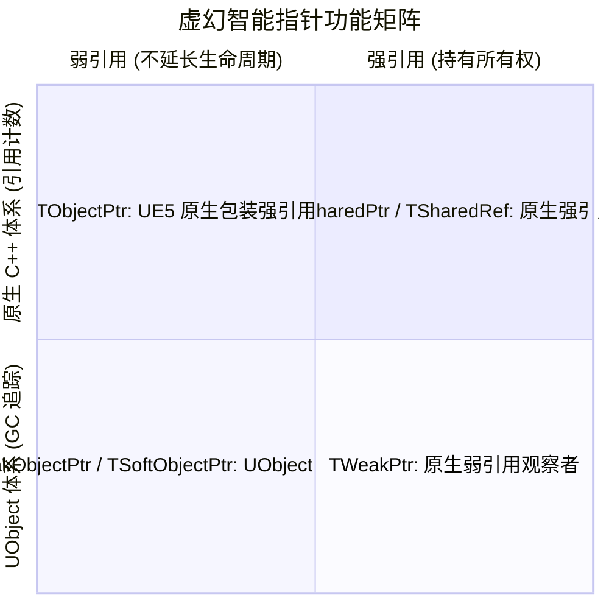
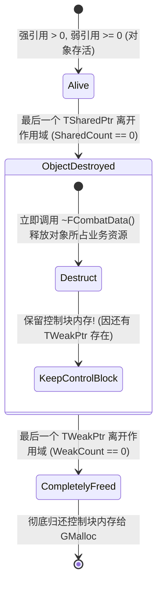
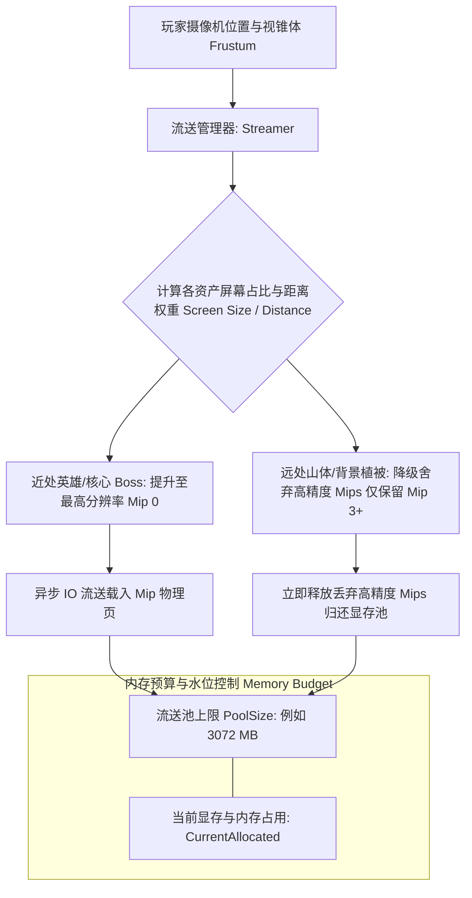
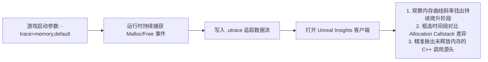

## 前言：从纯字节内存走向对象生命周期与资产托管

在[上篇《FMalloc 分配器、分桶机制与容器内存模型》](/posts/ue5-memory-allocators-and-containers-deep-dive)中，我们全面解析了虚幻引擎在操作系统虚拟内存之上建立的物理分配基石：分桶池化（Binned）、小对象内联优化（InlineAllocator）以及无锁分块字符串池（FNamePool）。

然而，纯粹的字节分配仅仅是故事的序曲。在实际的商业级 3A 研发中，更高频、更致命的内存挑战往往集中在中上层的**对象引用与资产托管**领域：
- **原生 C++ 智能指针（`TSharedPtr`）底层是如何分配控制块（Controller Block）的？`MakeShared` 与直接 `new` 相比到底强在哪里？**
- **在海量并发的开放世界中，数百兆的纹理与高精 Nanite 几何体，是如何通过“流送内存池（Streaming Pool）”在固定物理显存中循环换入换出的？**
- **面对偶发、难以复现的内存越界踩踏（Buffer Overflow）和野指针访问已释放内存（Use-After-Free），`FMallocStomp` 究竟使用了怎样的物理页保护黑魔法，能在触碰的纳秒瞬间锁定崩溃源码行号？**
- **项目上线遭遇移动端/主机端 OOM（Out Of Memory），如何结合 Unreal Insights（Memory Insights）与 LLM（Low-Level Memory Tracker）快速揪出潜伏的内存泄漏黑手？**

今天这篇下篇专题，我们将直击虚幻智能指针、资产流送机制与内存诊断工具链的最前线，打通虚幻内存体系的最后一公里。

---

## 一、智能指针内存模型与引用计数控制块

在虚幻引擎中，除了由 GC 托管的 `UObject*` 体系外，原生 C++ 对象的生命周期由一套完备的高性能智能指针体系接管。



---

### 1. 控制块（Reference Controller Block）内存剖析

很多开发者习惯这样写：
```cpp
// 方式 A：直接 new
TSharedPtr<FCombatData> DataA = TSharedPtr<FCombatData>(new FCombatData());

// 方式 B：推荐写法 MakeShared
TSharedPtr<FCombatData> DataB = MakeShared<FCombatData>();
```

虽然两者最终都得到了一个智能指针，但在**内存排布和系统调用**上，两者有着云泥之别：

```mermaid title="直接 new 与 MakeShared 的内存布局与缓存命中对比"
flowchart TD
    subgraph 方式 A: TSharedPtr 嵌套 new (两次离散堆分配)
        PtrA[栈上 TSharedPtr 指针] --> ChunkA1[堆内存块 1: FCombatData 真实对象数据]
        PtrA --> ChunkA2[堆内存块 2: FSharedReferencer 独立控制块<br/>SharedCount: 1 | WeakCount: 1]
        NoteA[缺点: 触发 2 次 Malloc; 内存离散容易 Cache Miss]
    end

    subgraph 方式 B: MakeShared 一次性连续分配 (极致缓存友好)
        PtrB[栈上 TSharedPtr 指针] --> ChunkB[单个连续堆内存块: 尺寸 = sizeof ControlBlock + sizeof FCombatData]
        ChunkB --- Part1[FSharedReferencer 紧凑控制块]
        ChunkB --- Part2[FCombatData 真实对象数据]
        NoteB[优势: 仅 1 次 Malloc; 强引用与数据位于同一缓存行 Cache Line]
    end
```

#### 为什么必须首选 `MakeShared`？
1. **减少 50% 的分配次数：** `MakeShared` 利用 C++ 模板在内部计算出 `控制块 + 业务对象` 的总字节尺寸，**向 `GMalloc` 仅发起一次连续内存申请**；而直接 `new` 会分别申请对象堆和控制块堆（2 次分配）；
2. **CPU 缓存行（Cache Line）友好：** 控制块和对象数据在物理内存上紧挨在一起。当 CPU 读取引用计数的同时，就顺道把对象的前几十个字节通过 L1/L2 预取器加载进高速缓存中！

---

### 2. 强弱引用的生命周期脱钩（Lifecycle Decoupling）

在控制块中，同时记录着两个 32 位的整型计数器：
- **`SharedReferenceCount`（强引用计数）：** 当其归零时，触发 **`FCombatData` 对象的析构函数（调用 `~FCombatData()`）**；
- **`WeakReferenceCount`（弱引用计数）：** 只要还有任意一个 `TWeakPtr` 指向该对象，弱引用计数就大于 0。



> ⚠️ **关键认知：**  
> 当强引用归零时，对象的 C++ 析构函数会被立即执行，相关持有的文件句柄、子资源均被释放；但**控制块本身的几十字节内存并不会立刻还给系统**！它必须等待所有正在观察它的 `TWeakPtr` 全部销毁后，控制块才会完成物理消亡。

---

### 3. UObject 专属指针：TObjectPtr vs TWeakObjectPtr

与原生 C++ 的引用计数不同，`UObject` 的指针生命周期完全交由垃圾回收器（GC）统管。

#### ① `TObjectPtr<T>`（UE5 的划时代升级）
在 UE5 中，所有的 `UPROPERTY()` 裸指针（如 `AActor*`）被官方强制建议替换为 `TObjectPtr<AActor>`。
- **Release / Shipping 构建下：** `TObjectPtr` 在编译期完全内联展开为一个**纯粹的原生 64 位裸指针**，完全零内存开销、零间接寻址；
- **Editor / Development 构建下：** 它充当一层智能句柄，负责在编辑器中拦截未加载资产的动态解析（Lazy Load / Soft Object Handle）、非法访问追踪以及动态属性访问监听。

#### ② `TWeakObjectPtr<T>` 的无控制块神技
原生 `TWeakPtr` 需要在堆中维系控制块，而 `TWeakObjectPtr` 的体积只有区区 **8 字节（Index + SerialNumber）**！
- 内部仅仅记录了目标对象在全局对象池 `GUObjectArray` 中的索引号（`ObjectIndex`）和创建序列号（`SerialNumber`）；
- 当你调用 `WeakPtr.IsValid()` 时，它直接拿保存的序列号去全局数组对应槽位比对：如果槽位上的序列号已变（说明旧对象已被 GC 且槽位被新对象复用），则判定失效！**完全零堆内存开销，极度适合 UI、AI 仇恨目标等临时观察者场景。**

---

## 二、资产与流式内存管理（Streaming Memory Pool）

在当今动辄几十平方公里的开放世界游戏中，哪怕拥有 16GB 的物理显存，也绝不可能把全地图的 4K 贴图和数十亿多边形一次性常驻在内存中。虚幻引擎依靠**流送内存池（Streaming Pool）**实现了内存的动态高低水位平衡。



---

### 1. 纹理流送（Texture Streaming）的 Mip 分页剥离

虚幻纹理在磁盘上不是单张图片，而是预先烘焙好了的 **Mipmap 链条**（从最大的 4096 原始图依次减半缩小到 32 像素缩略图）。

- **流送池限制（`r.Streaming.PoolSize`）：**  
  引擎在启动时为纹理划分了一块固定的物理内存/显存池（例如 3GB）；
- **动态换入换出：**  
  流送器每帧根据物体与摄像机的距离，计算所需的最佳 Mip 级别。当物理池即将见顶时，引擎会**优先将远处物体的顶部高精度 Mip 数据从内存中直接丢弃（Evict）**，只保留低精度的几层；当玩家走向远处时，再通过异步 IO 将高精度的 Mip 页面拉回内存。

---

### 2. 虚拟几何体 Nanite 的流送分页（Page Streaming Cache）

UE5 的 Nanite 几何体彻底打破了传统网格体的内存加载方式：
- **微网格集群（Clusters）：** 模型不再整体加载，而是被切碎为包含 128 个三角形的微型簇；
- **固定显存分页池：** Nanite 预先在 GPU 显存中开辟一组固定尺寸的物理页缓存（Cache Pages）；
- **视锥可见性驱动：** 只有当前帧被摄像机视锥体可见且尺寸达标的 Clusters，才会从磁盘流送进显存页；遮挡剔除（Occlusion Culling）背面的海量三角形甚至**从始至终从未踏入过物理内存一步**！

---

## 三、内存分析与排查诊断工具链实战（Profiling & Diagnostics）

面对复杂的内存泄漏、野指针踩踏与 OOM，单靠“看代码猜 Bug”无异于大海捞针。虚幻内置了一套从轻量统计到汇编级硬件拦截的武器库。

---

### 1. 物理页踩内存诊断神器：FMallocStomp

这是所有 C++ 开发者面对**偶发性内存越界、野指针幽灵 Crash** 时最具决定性的王炸工具。

#### 开启方式：
命令行追加启动参数：`-malloc=stomp`

#### 底层物理页保护原理：
普通的分配器（如 Binned）把对象紧密地挨着排布。如果代码在 `Array[10]` 后面偷偷写越界到了 `Array[11]`，此时不会崩溃，而是悄悄改写了邻居对象的数据；直到几秒钟之后邻居对象调用虚函数时才会诡异崩溃，导致调用栈现场被严重污染，根本找不到真正的凶手。

```mermaid title="FMallocStomp 物理页保护拦截内存踩踏机理"
flowchart TD
    subgraph 虚拟内存映射页 (Page Alignment 4KB)
        DataPage[数据物理页: 允许读写 PAGE_READWRITE<br/>你的对象放在该页最末尾对齐边界!]
        GuardPage[保护哨兵页: 严格禁止访问 PAGE_NOACCESS]
        DataPage --- GuardPage
    end

    NormalCode[代码合法访问: MyObj->Data] --> DataPage
    BadCode[代码越界写入: MyObj->Data[1000] 越过边界!] -. 触碰边界瞬间 .-> GuardPage
    GuardPage --> HWCrash[💥 CPU 硬件级内存保护中断 (0xC0000005)<br/>调用栈精准定格在当前违规写入代码行!]
    style HWCrash fill:#ffdddd,stroke:#ff0000,stroke-width:2px;
```

1. **精准抓取缓冲区越界（Buffer Overflow）：**  
   `FMallocStomp` 故意把分配出的对象内存放置在虚拟内存页的最末尾，紧挨着它的下一页被标记为操作系统的 **`PAGE_NOACCESS`（不可访问哨兵页）**。只要指针写入越界哪怕 1 个字节，CPU 立即触发硬件级访问违规中断，调用栈精准定格在罪魁祸首代码行！
2. **精准抓取释放后使用（Use-After-Free）：**  
   一旦对象调用 `Free`，该物理页立即被置为 `PAGE_NOACCESS` 且永不释放。任何旧指针在未来尝试读取或写入它，瞬间命中崩溃，让野指针无所遁形！

---

### 2. Unreal Insights - Memory Insights 深度实战

作为 UE5 最强大的官方性能分析中间件，Memory Insights 具备调用栈级（Callstack）的内存溯源能力。



#### 实战排查四步法：
1. **启动捕获：** 游戏启动附带参数：`-trace=memory,default`；
2. **观察内存趋势图（Memory Graph）：** 如果某条子系统曲线在关卡循环切换中呈现单调阶梯状上升，必然存在内存泄漏；
3. **分配符号回溯（Allocations Table）：** 框选泄漏时间段，按字节总量降序排列，展开调用栈，直接能看到是哪一个静态数组、哪一行 `new` 持续申请了内存未归还；
4. **实时追踪快照标记（Memory Tagging）：** 支持筛选特定的 LLM 标签（如 Audio、Rendering、Gameplay）。

---

### 3. LLM（Low-Level Memory Tracker 底层内存追踪器）

在没有 GUI 分析工具的打包版本（如移动端真机或 Linux 专用服务器）中，LLM 是最快速的宏观内存看板。

#### 核心常用指令：
- **`stat memory`：** 屏幕实时打印整体内存水位、物理内存使用率与物理池剩余；
- **`memreport -full`：** 生产环境中最重要的内存体检命令！它会在 `Saved/Profiling/` 目录下生成一份巨细靡遗的文本快照，清晰导出：
  - 每一个加载的 `UTexture`、`USkeletalMesh` 的物理分辨率和显存占用；
  - 每一个关卡中的 Actor 数量与组件开销；
- **`obj list class=Texture2D -alphasort`：** 按照字母顺序打印当前内存中所有存活的贴图对象，瞬间找出是谁没有被正常卸载。

---

## 四、3A 级开发内存泄漏与 OOM 典型事故避坑手册

---

### 1. 致命天坑：异步加载 Lambda 闭包隐式强引用导致资产死锁

```cpp
// ❌ 灾难代码：隐式强引用导致大关卡资产永久无法释放
void UMyAssetManager::LoadLevelBonus(TSoftObjectPtr<UTexture2D> BonusIcon)
{
    // 发起异步加载
    StreamableManager.RequestAsyncLoad(BonusIcon.ToSoftObjectPath(), [this, BonusIcon]()
    {
        // 💥 闭包按值拷贝捕获了 BonusIcon，其内部隐式持有了强引用对象指针！
        // 只要这个 Lambda 尚未执行完毕，或者回调被全局委托长期持有，
        // 哪怕当前关卡卸载，BonusIcon 所代表的巨型贴图也永远无法被 GC 判定为不可达！
        ApplyIconToHUD(BonusIcon.Get());
    });
}
```

#### 正确工程范式：弱引用安全捕获
```cpp
// ✅ 安全范式：使用 TWeakObjectPtr 防御性回调
TWeakObjectPtr<UMyAssetManager> WeakThis(this);
StreamableManager.RequestAsyncLoad(BonusIcon.ToSoftObjectPath(), [WeakThis, BonusIcon]()
{
    if (UMyAssetManager* StrongThis = WeakThis.Get())
    {
        StrongThis->ApplyIconToHUD(BonusIcon.Get());
    }
});
```

---

### 2. 内存高水位常驻：容器长期只增不减

在战斗系统中，很多缓存数组（如伤害计算历史、受击目标池）在激战期间扩容到了 50000 个元素，占用了大量内存。

```cpp
// ⚠️ 隐性内存浪费：Empty 并没有归还内存给操作系统！
HistoryDamageList.Empty(); 
```

#### 为什么 `Empty()` 之后内存没降？
`TArray::Empty()` 的默认行为是：**清空元素计数（`ArrayNum = 0`），但保留底层预分配的连续内存块（`ArrayMax` 保持不变）**，以便下次复用。
- 如果这个容器只有特定战斗阶段才达到峰值，战斗结束后它将长期霸占着几兆的物理内存，导致物理高水位（High Watermark）居高不下；
- **正确释放方案：**
  ```cpp
  HistoryDamageList.Empty();
  HistoryDamageList.Shrink(); // 显式调用 Shrink() 将闲置的 Capacity 彻底归还给物理分配器！
  ```

---

## 五、全景速查对照表与系列终局总结

至此，我们用一张全景思维图谱，为整个 **《UE5 内存架构与底层优化深度解析》** 系列画上圆满句号：

```mermaid title="UE5 内存管理底层全谱系技术闭环"
flowchart TD
    subgraph 物理分配层 (上篇核心)
        F1[FPlatformMemory 虚拟页] --> F2[FMallocBinned2/3 分桶归一]
        F2 --> F3[SBO: TInlineAllocator 0堆开销]
        F2 --> F4[FNamePool 8字节分块无锁池]
    end

    subgraph 引用托管层 (下篇核心)
        F2 --> R1[MakeShared 控制块连续分配]
        F2 --> R2[TWeakObjectPtr 全局序列号0控制块]
        R1 --> R3[Streaming Pool 显存与贴图分页流送]
    end

    subgraph 诊断优化层 (实战核心)
        D1[FMallocStomp: 物理页哨兵抓越界/野指针]
        D2[Memory Insights: 调用栈级别泄漏追踪]
        D3[LLM / memreport: 生产环境宏观内存体检]
    end

    F3 --> R1
    R3 --> D2
```

### 核心结论速记：
1. **控制块首选 `MakeShared`**：一次性分配连续内存，告别二次堆碎片，缓存命中率倍增；
2. **`TWeakObjectPtr` 是性能奇迹**：8 字节无独立控制块，直接利用全局对象池序列号秒级验活；
3. **流送池靠的是距离预算**：纹理分级丢弃，Nanite 视锥按簇分页，显存占用恒定可控；
4. **抓踩内存必用 `FMallocStomp`**：边界插入只读页，触碰纳秒级定格崩溃源代码；
5. **容器清空莫忘 `Shrink()`**：峰值退去需压实，杜绝无意义的内存高水位常驻。
