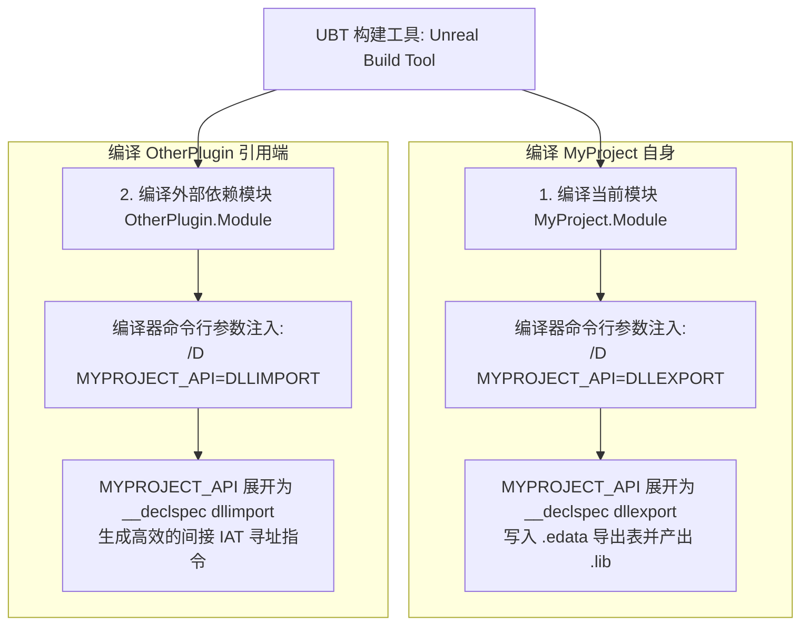
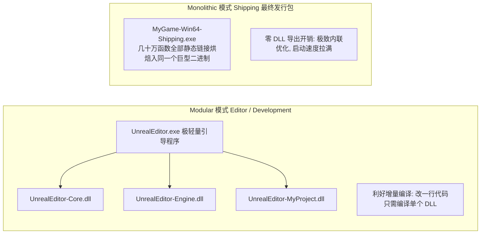
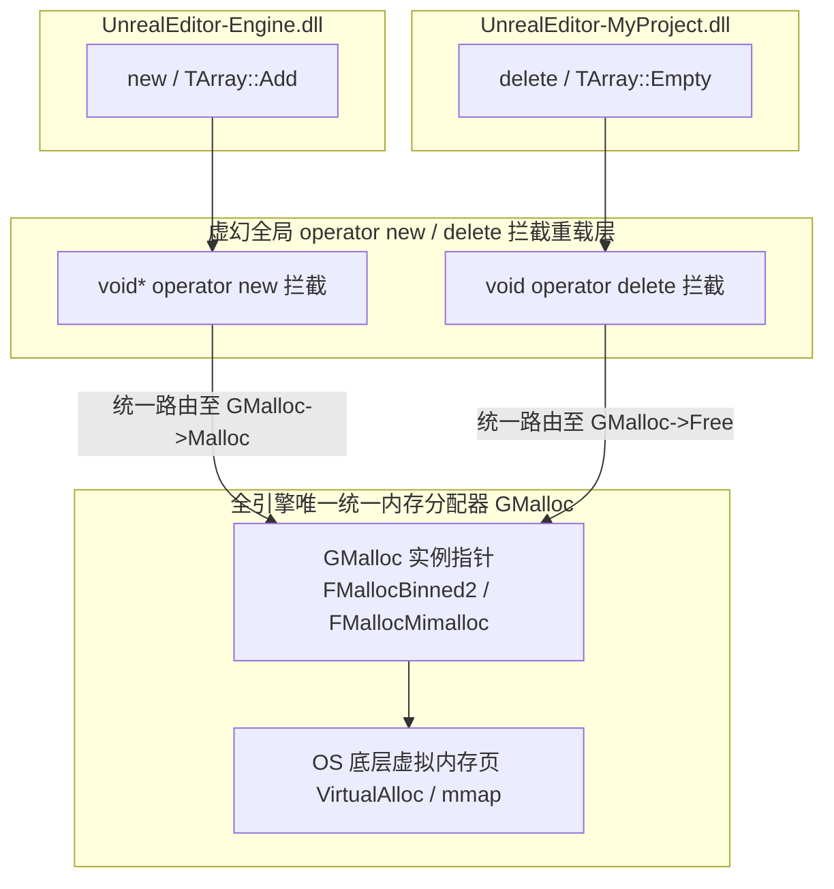
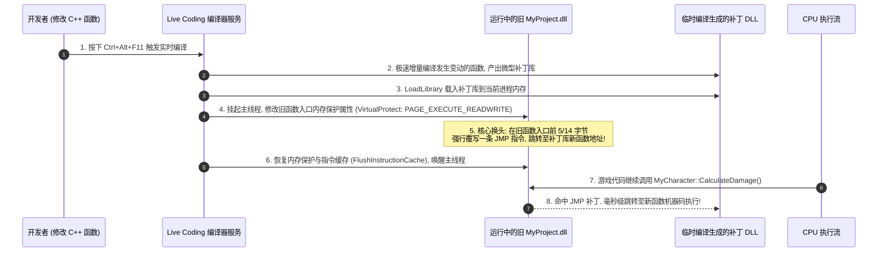
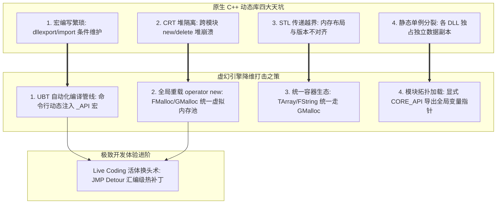

## 前言：虚幻引擎的模块化帝国

在[上篇《PE 机制、ABI 稳定性与跨 DLL 内存天坑》](/posts/cpp-dll-architecture-and-abi-deep-dive)中，我们全面领教了原生 C++ 在面对动态链接时的诸多残酷陷阱：
- 导出宏声明冗长繁琐；
- CRT 堆边界导致跨模块内存释放直接崩溃；
- STL 标准库容器跨 DLL 传递必然越界；
- 模板静态单例在不同模块分裂成“多胞胎”。

然而，当你打开虚幻引擎（Unreal Engine）源码时，你会发现一个不可思议的工程奇迹：
- 整个引擎被拆分为**数百个完全独立的模块（Modules）**（如 `Core`、`CoreUObject`、`Engine`、`RenderCore`）；
- 在编辑器或开发构建下，这些模块被分别编译为**上百个独立的 `.dll` 二进制文件**；
- 开发者在 C++ 中可以随心所欲地跨 DLL 传递 `TArray`、`FString`、`TMap`，却**从未发生过任何 CRT 堆崩溃**；
- 只需要在类前面写一个简短的 `MYPROJECT_API`，引擎就会自动搞定复杂的导出导入；
- 更令人惊叹的是：在游戏运行期间，你甚至可以在 Visual Studio 中修改 C++ 代码并按下 `Ctrl+Alt+F11`，**引擎在毫秒级内完成动态重编译，并立即在运行中的游戏里生效（Live Coding）**！

虚幻引擎究竟施展了怎样的工程魔法，才将原生 C++ 的动态库天坑彻底降维抚平？
今天这篇下篇，我们将直击虚幻底层构建工具（UBT）、内存分配器（FMalloc）与 Live Coding 汇编换头术的核心源码腹地。

---

## 一、UBT 模块编译模型与 `MYPROJECT_API` 自动化展开

在原生 C++ 中，每个动态库都要写一大堆繁重的宏判断（如 `#ifdef BUILDING_DLL ... #define API __declspec(dllexport)`）。而在虚幻中，我们只需要统一写上：

```cpp
class MYPROJECT_API AMyPlayerCharacter : public ACharacter
{
    GENERATED_BODY()
    // ...
};
```

### 1. UBT 的预处理器动态注入魔法

为什么同一个宏 `MYPROJECT_API`，在当前模块里自动变成 `__declspec(dllexport)`，在别的模块引用它时又自动变成 `__declspec(dllimport)`？

**幕后推手正是虚幻编译系统——UBT（Unreal Build Tool）。**



#### 源码真相：
当 UBT 调度 MSVC/Clang 编译代码时，它会读取 `MyProject.Build.cs`：
1. **当编译器正在编译 `MyProject` 模块内部的 `.cpp` 时：**  
   UBT 在编译器命令行中自动注入全局宏定义：  
   `-DMYPROJECT_API=DLLEXPORT`（在 Windows 平台即展开为 `__declspec(dllexport)`）；
2. **当编译器正在编译其他模块（如 `OtherPlugin`），而该模块包含了 `MyPlayerCharacter.h` 时：**  
   UBT 检查到该模块只是使用者，自动注入命令行参数：  
   `-DMYPROJECT_API=DLLIMPORT`（展开为 `__declspec(dllimport)`）；
3. 开发者无需手动维护任何条件编译头文件，UBT 在编译期自动完成了进出身份的无感切换！

---

### 2. 模块化构建 vs 宏构单体（Modular vs Monolithic）

在虚幻引擎中，代码组织结构在不同目标平台与发布配置下，会发生根本性的拓扑裂变：



- **Modular（模块化构建）：**  
  在 Editor 或 Debug 模式下使用。每个 Module 编译为一个独立的动态库。修改代码后，C++ 编译器只需要重新编译和链接发生改动的那个小 DLL，极大缩短开发迭代等待时间；
- **Monolithic（单体构建）：**  
  在最终发行的 **Shipping 包** 中使用。此时全引擎所有模块的代码被直接静态链接（Static Link）进唯一的 `MyGame.exe` 中！  
  **核心收益：** 在 Shipping 模式下，UBT 会把所有 `_API` 宏（`ENGINE_API`、`CORE_API`）**全部替换为空宏**！消除所有 DLL 导入导出跳板，允许编译器（MSVC/Clang）开启激进的跨模块链接时优化（LTO / LTCG）与跨函数内联，榨干最后一滴 CPU 性能。

---

## 二、神级破局：虚幻如何彻底打破 CRT 堆隔离？

我们在上篇反复强调：**原生 C++ 绝对不能在 DLL 之间跨模块传递动态容器（如 `std::vector`），也不能跨模块 `new` 和 `delete`，否则会因为 CRT 独立堆句柄不同而直接崩溃！**

那为什么在虚幻中，我们可以随意把一个在 `Core` 里分配的 `TArray<FString>` 传给 `Engine`，又在 `MyProject.dll` 里面 `Add()` 或清空，却从来不会遇到 `Heap Corruption`？

**答案是：虚幻引擎重载了全局 `operator new`，并以统一的抽象内存池 `FMalloc`（`GMalloc`）彻底架空了操作系统的 CRT 堆！**



### 1. 拦截底层分配入口

每个虚幻模块在编译时，都会强制引入 `Core` 模块的底层基础头。虚幻重载了全局的 C++ 操作符：

```cpp
// 虚幻引擎全局重载 new / delete (位于 Core 模块)
void* operator new(size_t Size)
{
    return FMemory::Malloc(Size);
}

void operator delete(void* Ptr) noexcept
{
    FMemory::Free(Ptr);
}
```

而在 `FMemory::Malloc` 与 `FMemory::Free` 的背后，是指向全引擎全局唯一的内存管理器单例——**`GMalloc`**：
```cpp
// 最终全部路由至底层的统一分配器实例
void* FMemory::Malloc(size_t Size, uint32 Alignment)
{
    return GMalloc->Malloc(Size, Alignment);
}
```

### 2. 为什么从此再无堆隔离崩溃？
- 无论是在 `Engine.dll` 还是 `Game.dll`，当容器扩容（`Realloc`）或释放时，底层调用的**根本不是各个 DLL 本地独立的 CRT `malloc`/`free`**；
- 它们统统直接调用导出指针 `GMalloc` 的虚函数！
- 所有内存全部由虚幻自己的分桶内存池（如 `FMallocBinned2`、`FMallocBinned3` 或 `Mimalloc`）直接向操作系统申请的大块虚拟内存页（`VirtualAlloc`）统一吞吐和切片；
- **分配和释放在同一个大内存池中闭环，CRT 堆隔离在虚幻架构中被直接彻底消除！**

---

## 三、全局单例与核心状态如何跨 DLL 保持绝对唯一？

我们在上篇分析过，模板单例如果作为头文件展开，在不同 DLL 中会实例化出多个独立副本（“多胞胎现象”）。

但在虚幻中，`GEngine`、`GUObjectArray`、`GLog` 等全局核心状态，在几十个 DLL 中访问永远指向同一个物理实例。虚幻是如何实现的？

### 1. 导出全局符号指针（CORE_API extern）

虚幻严禁将单例的物理存储直接定义在头文件中。所有的全局核心单例，物理内存必须严格安放在 `Core` 或 `CoreUObject` 内部的某一个 `.cpp` 文件中：

```cpp
// CoreGlobals.h (对外头文件)
// 声明该指针属于 CORE_API 导出符号
extern CORE_API UEngine* GEngine;

// CoreGlobals.cpp (Core 模块内部的源文件)
// 真正为该指针在 .data 节区分配 8 字节物理内存空间的地方！
CORE_API UEngine* GEngine = nullptr;
```

当其他模块（如 `MyProject.dll`）访问 `GEngine` 时：
编译器生成读取导入符号 `__imp_GEngine` 的指令，解析并精确读取 `Core.dll` 数据节区中的那个唯一地址，确保所有 DLL 共享同一套内存大脑。

---

### 2. 模块生命周期管理器与拓扑依赖排序

每个虚幻模块都是一个合法的 C++ 动态库，它们通过实现 **`IModuleInterface`** 来托管自己的生命周期：

```cpp
class FMyGameModule : public IModuleInterface
{
public:
    virtual void StartupModule() override
    {
        UE_LOG(LogTemp, Log, TEXT("MyGame 模块加载就绪！初始化内部单例与反射注册"));
    }

    virtual void ShutdownModule() override
    {
        UE_LOG(LogTemp, Log, TEXT("MyGame 模块即将卸载！安全清理资源"));
    }
};

// 导出模块工厂宏
IMPLEMENT_MODULE(FMyGameModule, MyGame)
```

#### 模块加载器的拓扑排序（Topological Sort）
当游戏或编辑器启动时，`FModuleManager` 负责扫描所有动态库：
1. 分析每个模块的 `.uplugin` 或 `Build.cs` 中的 `PublicDependencyModuleNames`；
2. 构建出**有向无环图（DAG, Directed Acyclic Graph）**；
3. 按照拓扑排序，**严格从底层到上层依序调用 `LoadLibrary` 和 `StartupModule()`**（先加载 `Core` ➔ 再加载 `CoreUObject` ➔ 再加载 `Engine` ➔ 最后加载你的游戏业务模块）；
4. 退出或卸载时，严格按照完全相反的逆序调用 `ShutdownModule()`，彻底杜绝悬挂指针与析构顺序未定义的隐患。

---

## 四、活体换头术：Hot Reload 与 Live Coding 的底层原理

这是虚幻 C++ 开发中最具黑科技色彩的领域。在游戏运行期间，不关闭客户端就能让修改后的 C++ 逻辑立刻生效，引擎究竟经历了什么？

### 1. 传统 Hot Reload（旧版热重载）的弊端

在早期 UE4 时代，热重载采用的是一种朴素的**“生新换旧”**逻辑：
1. 编译生成带后缀的全新 DLL（例如 `MyProject-3421.dll`）；
2. 通过 `LoadLibrary` 载入新 DLL；
3. **Reinstancing（重实例化）：** 遍历旧类反射体系，在内存中创建新对象，通过序列化把旧对象的属性拷到新对象上，再把旧对象标记为垃圾；
4. **致命痛点：** 旧 DLL 的机器码在 Windows 下无法被真正卸载（文件锁）；指针重定向极易遗漏，导致悬挂野指针；蓝图继承状态频繁丢失，容易引发编辑器死锁崩溃。

---

### 2. 现代 Live Coding（实时代码热补丁）：JMP 汇编重定向

从 UE 4.22 开始引入、并在 UE5 中成为行业标准的 **Live Coding（基于 Live++ 引擎集成）**，抛弃了笨拙的整类重实例化，直接在**汇编指令级**实施了无损的“活体换头术”。



#### 汇编级真相：什么是 JMP Detour？
当你在 `AMyCharacter::CalculateDamage` 里把伤害倍率从 `1.0f` 改成了 `2.0f` 时：
1. Live Coding 仅编译修改了的那个 `.cpp`，生成一个小小的补丁模块；
2. 找到进程内存中旧函数 `AMyCharacter::CalculateDamage` 的机器码首地址；
3. 调用 Windows API `VirtualProtect` 把该内存页赋予写权限；
4. **直接在旧函数的前几个字节上，用硬编码覆写一条绝对跳转汇编指令：**
   ```asm
   ; 机器码: FF 25 00 00 00 00 [64位绝对地址]
   jmp qword ptr [New_CalculateDamage_Address]
   ```
5. 刷新 CPU 指令缓存（`FlushInstructionCache`）。

#### 为什么 Live Coding 如此稳定？
- **对象不动、内存排布不动、虚表不动！**
- 场景中原本的一万个怪物依然生活在原地，指针地址分毫不变；
- 下一帧当怪物调用该函数时，刚刚踏入旧函数大门，瞬间就被门口的 `jmp` 传送门神不知鬼不觉地甩进了新函数的代码段！整个过程在几十毫秒内完成，零掉帧、零对象销毁！

> ⚠️ **Live Coding 的唯一红线：**
> **它只支持函数体内的实现修改，绝对不支持修改类的内存布局！**  
> 如果你在头文件中增加或删除了一个成员变量（修改了类的大小或属性偏移），必须关闭编辑器完全重新编译，否则旧内存模型对齐错位必将引发系统崩溃！

---

## 五、3A 级模块开发避坑与最佳实践

---

### 1. 致命编译死锁：模块间的循环依赖（Circular Dependency）

```
Module A (Combat) 依赖 Module B (Inventory)
Module B (Inventory) 又依赖 Module A (Combat)
```

- **恶果：** 在动态链接体系下，链接器在解析符号导入导出时会陷入“先有鸡还是先有蛋”的环路，导致 UBT 抛出严重的编译错误或静态初始化死锁；
- **重构原则：**  
  提取公共下层模块（如新建一个轻量级的 `CombatCore` 或 `CombatTypes`），让两者单向依赖底层，或通过基于纯虚类的接口模块进行反向依赖注入。

---

### 2. 避免在 DLL 导出头文件中滥用重型 Inline 函数

```cpp
// ⚠️ 高危实践：在导出头文件中直接内联复杂函数
class MYPROJECT_API FCombatFormula
{
public:
    inline static float Calculate(float InBase)
    {
        // 包含大量复杂计算
        return InBase * 1.5f + 10.0f;
    }
};
```

- **问题：** 内联函数的机器码会被直接嵌入到每一个包含它的引用模块（Calling Modules）中；
- 一旦某天你在 DLL 内部修改了计算逻辑，但外部模块没有被完全重新编译，外部模块依旧在固执地执行旧的内联代码，导致不同 DLL 运算结果产生严重的分歧与薛定谔 Bug！
- **准则：** 跨模块导出的 API，函数体**必须移至 `.cpp` 中**，由链接器通过导入导出表统一定址。

---

## 六、全景架构对照与系列终局总结

至此，我们用一张终极脑图，为整个 **《现代 C++ 与虚幻模块化底层：DLL 全景解密》** 系列画上圆满的句号：



### 核心结论速记：
1. **`MYPROJECT_API` 不是静态宏**：它是由 UBT 在编译期根据编译目标身份（作者 vs 读者）动态注入的权限门禁；
2. **`FMalloc` 是一切跨模块容器的定海神针**：它彻底消灭了 CRT 堆隔离，赋予了虚幻跨 DLL 安全自由传递数据结构的底气；
3. **Live Coding 是高维度的热补丁艺术**：利用内存写保护提升与汇编 `jmp` 偷梁换柱，实现了对象原位不动的函数逻辑毫秒级实时刷新！
