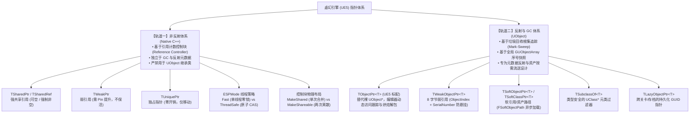
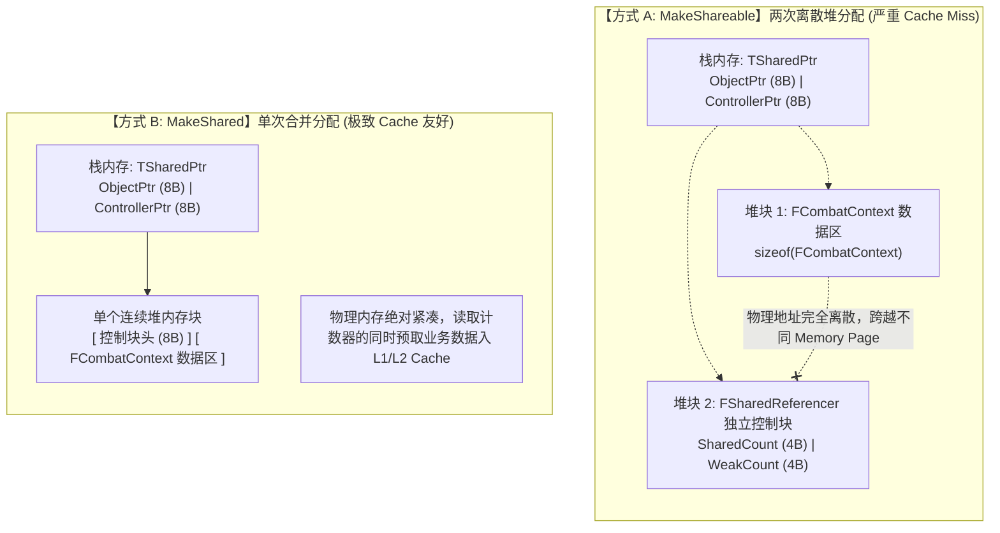
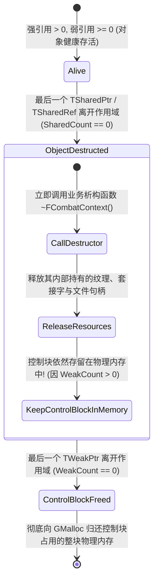
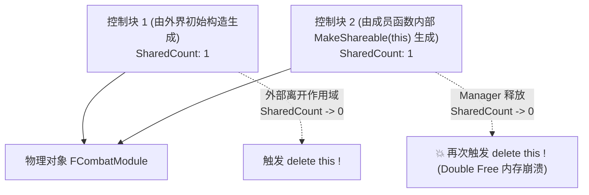
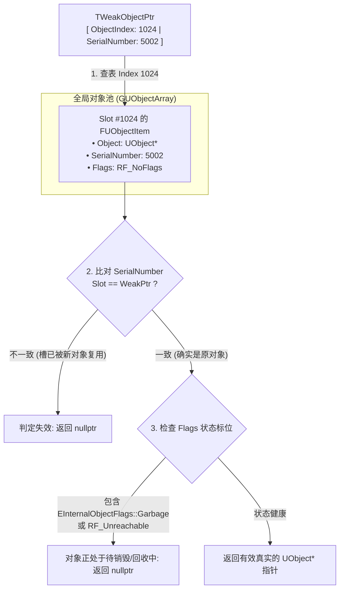
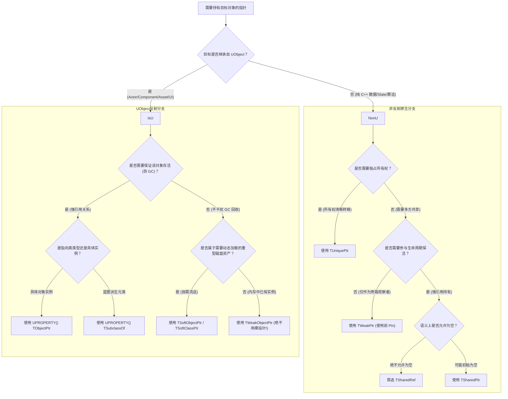

## 前言：虚幻世界中的指针二元对立

在现代 C++ 游戏引擎研发中，**对象的生命周期管理**是决定系统健壮性、缓存效率与抗崩溃能力的绝对底线。

很多从中小型项目转入 3A 虚幻研发的开发者，往往会下意识带入标准库 `std::shared_ptr` / `std::weak_ptr` 的编程惯性，进而在虚幻庞大的代码库中陷入困惑：
- **为什么虚幻要抛弃 `std`，自研一套几乎等价的 `TSharedPtr`、`TSharedRef`、`TWeakPtr`？**
- **为什么在类成员里写一个 `AActor*`，只要忘了写 `UPROPERTY()`，游戏跑着跑着指针就会变成野指针？**
- **为什么严禁对 `UObject` 派生类使用 `TSharedPtr` 或 `TWeakPtr`？**
- **`TWeakObjectPtr` 为什么只有区区 8 个字节？在没有传统“控制块”的情况下，它是如何做到零开销防悬挂与杜绝野指针访问的？**
- **UE5 为什么要用 `TObjectPtr<T>` 替换历史悠久的原始裸指针 `UObject*`？**

要回答这些问题，必须首先确立一个核心认知：**虚幻引擎的指针体系存在着两大泾渭分明、物理隔离的平行宇宙——「非反射体系（Native C++）」与「UObject 反射与 GC 体系」**。



本文将从源码底层出发，横向拆解这两套体系的内存排布、运行时代价、生命周期流转，以及它们与引擎垃圾回收（GC）、全局对象池（`GUObjectArray`）和资产加载器的深度交互。

---

## 一、轨道一：非 UObject 原生智能指针体系（Native C++）

> **适用场景：** Slate UI 控件树、算法数据结构、网络协议包、纯 C++ 业务逻辑层等**不继承自 `UObject` 的原生对象**。

虚幻之所以不直接采用 C++11 标准库的 `std::shared_ptr`，主要有三层核心考量：
1. **内存分配器绑定：** 标准库的 `std::make_shared` 默认走向操作系统的通用堆，绕过了虚幻专属的高性能池化分配器（如 `FMallocBinned2/3`），丧失了分桶与对齐优化的优势；
2. **强制非空契约：** 标准库缺少一种“语法层面永不为空”的强类型指针，虚幻由此自研了 `TSharedRef`；
3. **线程模型编译期裁剪：** 标准库的 `std::shared_ptr` 内部引用计数**强制使用原子操作**，即使在完全单线程的 UI 树中也必须付出总线锁与内存屏障的昂贵开销。虚幻通过 `ESPMode` 模板参数，将线程开销按需剥离。

---

### 1. 强引用对偶：`TSharedPtr` 与 `TSharedRef`

在虚幻引擎中，强引用共享指针是一对孪生兄弟：

```cpp
// 1. TSharedPtr: 语义上允许为空 (Nullable)
TSharedPtr<FCombatContext> ContextPtr = nullptr;
if (ContextPtr.IsValid())
{
    ContextPtr->Execute();
}

// 2. TSharedRef: 语义上绝对不可为空 (Non-Nullable)
TSharedRef<FCombatContext> ContextRef = MakeShared<FCombatContext>();
ContextRef->Execute(); // 永远无需判空，像 C++ 引用一样安全高效！
```

#### ① 为什么虚幻极度推崇 `TSharedRef`？
在工程实践中，防御性编程往往伴随着无节制的判空检查（`if (Ptr.IsValid())`）。这不仅带来了杂乱的样板代码，还会导致 CPU 分支预测失败。
* `TSharedRef` 在初始化后**在任何时刻都必然指向有效对象**；
* 它无法被赋值为 `nullptr`，也没有默认无参构造函数；
* **接口设计金律：** 当一个函数必须要求调用方传入有效对象，且内部需要共享其生命周期时，**形参必须声明为 `const TSharedRef<T>&`**。调用方若只有 `TSharedPtr`，就必须在调用点显式转换为 `TSharedRef`，从而将崩溃的第一责任锁定在调用发起方，而非深层实现处。

#### ② 相互转换的物理机制
* **`TSharedRef` $\rightarrow$ `TSharedPtr`：** 隐式无损转换。因为“永不为空”必然满足“允许为空”的宽泛约束。
* **`TSharedPtr` $\rightarrow$ `TSharedRef`：** 必须调用 `.ToSharedRef()` 显式转换。其底层源码包含严格断言：
  ```cpp
  // SharedPointerInternals.h
  FORCEINLINE TSharedRef<ObjectType, Mode> ToSharedRef() const
  {
      check(IsValid()); // 运行时若为空，立即断言熔断，绝不放过任何隐患！
      return TSharedRef<ObjectType, Mode>(*this);
  }
  ```

---

### 2. 控制块内存布局：`MakeShared` vs `MakeShareable`

使用智能指针时，最常见的两种构造方式在底层有着天壤之别：

```cpp
// 方式 A：MakeShareable 包装原生 new (强烈不推荐)
TSharedPtr<FCombatContext> PtrA = MakeShareable(new FCombatContext());

// 方式 B：MakeShared 原生工厂 (强力推荐)
TSharedPtr<FCombatContext> PtrB = MakeShared<FCombatContext>(Arg1, Arg2);
```

#### ① 物理内存排布剖析



#### ② 源码真相：为什么 `MakeShared` 快得多？
1. **系统分配次数减半：**
   * `MakeShareable` 触发两次 `GMalloc->Malloc()`：一次为用户对象分配内存，一次为控制块 `FSharedReferencer` 分配内存；
   * `MakeShared` 利用 C++ 模板在编译期计算出：
     $$\text{TotalSize} = \text{sizeof}(\text{TIntrusiveReferenceController}) + \text{sizeof}(\text{FCombatContext})$$
     仅向 `GMalloc` 请求**一次连续内存**，在同一块内存前部构造控制块，后部使用 Placement New 构造业务对象。
2. **CPU 缓存命中率（Cache Locality）：**
   在现代 CPU 架构中，访问内存控制器需要耗费上百个时钟周期。`MakeShared` 让控制块与业务对象位于同一个 64 字节的缓存行（Cache Line）或相邻缓存行。当代码检查 `Ptr.IsValid()` 读取引用计数的瞬间，CPU 硬件预取器（Hardware Prefetcher）就已经顺道将该对象的成员数据加载到了 L1/L2 高速缓存中。

---

### 3. 控制块与对象的生命周期脱钩（Lifecycle Decoupling）

控制块内部维系着两个 32 位的整型计数器：
* **`SharedReferenceCount`（强引用计数）：** 当其归零时，意味着**没有任何强指针持有该业务对象**；
* **`WeakReferenceCount`（弱引用计数）：** 当且仅当强引用与弱引用全部离开作用域归零时，控制块自身才会被销毁。



> [!WARNING] 缓存泄漏风险
> 如果你在某个全局生命周期管理器中存储了数万个 `TWeakPtr`，即使对应的业务对象早就析构了（`SharedReferenceCount == 0`），这些对象的控制块（以及 `MakeShared` 合并分配中尚未析构的对象空壳内存）依然会被强制“扣留”在堆中无法还给操作系统，直到所有弱指针被清空！

---

### 4. 多线程策略：`ESPMode::Fast` vs `ESPMode::ThreadSafe`

虚幻智能指针通过模板参数支持两种并发模式：

```cpp
template <class ObjectType, ESPMode Mode = ESPMode::Fast>
class TSharedPtr;
```

#### 为什么采用编译期模板参数，而非运行时布尔标记？
如果使用运行时布尔值，每一次指针的复制、赋值与解引用，内部都要执行 `if (bIsThreadSafe)` 的分支跳转。这会破坏指令流水线，并且为了实现虚析构还必须引入 8 字节的虚表指针（`vptr`）。
虚幻将其直接做成模板参数：
* **`ESPMode::Fast`（默认模式）：**
  内部使用原生的 `++` / `--`。没有原子锁、没有内存屏障，开销完全等同于原生 C 指针复制加上一条基础算术指令，适合单线程逻辑（如 Slate 控件树）。
* **`ESPMode::ThreadSafe`：**
  内部调用 `FPlatformAtomics::InterlockedIncrement` 与 `InterlockedDecrement`。由 CPU 总线锁定保证跨线程可见性，适合 TaskGraph 异步线程与渲染线程数据共享。

---

### 5. 弱引用安全提升：`TWeakPtr` 与 `Pin()`

`TWeakPtr` 绝不允许直接使用 `->` 或 `*` 运算符解引用！

#### 为什么禁止直接解引用？
假设允许直接读取：
```cpp
// 伪代码：极其危险的竞态假想
if (WeakPtr.IsValid()) // 线程 A 刚刚确认对象存活
{
    // <--- 此时操作系统切换到线程 B，线程 B 把最后一个强指针释放，对象被析构！
    WeakPtr->DoSomething(); // 线程 A 恢复执行：访问非法悬挂内存，引发不可挽回的崩溃！
}
```

#### `Pin()` 源码级原子防御
解决竞态条件的唯一正确手段是**提升（Pin）**：
```cpp
TSharedPtr<FCombatContext> PinnedPtr = WeakPtr.Pin();
if (PinnedPtr.IsValid())
{
    // 在这块作用域内，PinnedPtr 作为一个强引用，绝对保证对象不会在此刻被析构！
    PinnedPtr->DoSomething();
}
```

其底层汇编级逻辑通过原子比较并交换（CAS）实现：
```cpp
// SharedPointerInternals.h
bool ConditionallyAddSharedReference()
{
    int32 OriginalCount = SharedReferenceCount;
    while (OriginalCount > 0)
    {
        // 如果计数大于 0，尝试原子加 1
        if (FPlatformAtomics::InterlockedCompareExchange(&SharedReferenceCount, OriginalCount + 1, OriginalCount) == OriginalCount)
        {
            return true; // 成功锁死生命周期
        }
        // 如果中途被其他线程修改了，重新读取最新值重试
        OriginalCount = SharedReferenceCount;
    }
    return false; // 强引用已归零，目标已死亡，拒绝提升
}
```

---

### 6. `TSharedFromThis` 与双控制块自毁陷阱

如果在原生 C++ 类的成员函数中需要把自己传递给其他系统，开发者很容易写出这样致命的代码：

```cpp
class FCombatModule
{
public:
    void RegisterToManager(FManager& Manager)
    {
        // 💥 致命陷阱：千万不要这样写！
        TSharedRef<FCombatModule> Self = MakeShareable(this);
        Manager.Register(Self);
    }
};
```



#### 正确姿势：继承 `TSharedFromThis<T>`
```cpp
class FCombatModule : public TSharedFromThis<FCombatModule>
{
public:
    void RegisterToManager(FManager& Manager)
    {
        // ✅ 正确安全：获取已有控制块的引用，绝不创建新控制块
        TSharedRef<FCombatModule> Self = AsShared();
        Manager.Register(Self);
    }
};
```
`TSharedFromThis` 内部藏有一个 `TWeakPtr<FCombatModule>`。当对象第一次被 `MakeShared` 创建时，控制块会自动将其弱指针初始化；调用 `AsShared()` 时，其实就是调用了该弱指针的 `Pin().ToSharedRef()`，保证全局只有一个控制块。

---

## 二、轨道二：UObject 反射与垃圾回收（GC）体系

> **适用场景：** 所有继承自 `UObject` 的类型，包括 `AActor`、`UActorComponent`、`UTexture`、`UStaticMesh`、UI `UUserWidget` 等。

在 UObject 的世界里，**没有 C++ 控制块，所有对象的生死由垃圾回收器（GC）统管**。

---

### 1. UE5 核心演进：`TObjectPtr<T>` 的物理真相

在虚幻引擎 5 中，官方将引擎头文件中的裸指针全面重构为 `TObjectPtr<T>`：

```cpp
// UE4 传统写法
UPROPERTY()
AActor* TargetActor;

// UE5 推荐标准写法
UPROPERTY()
TObjectPtr<AActor> TargetActor;
```

#### ① 为什么 UE5 要革原生裸指针的命？
在过去，原始裸指针 `AActor*` 只是一串毫无知觉的 64 位内存地址。当引擎需要做一些高级架构优化（例如动态追踪资产访问频率、在编辑器内实现资产的动态懒加载解析 Lazy Load）时，裸指针无法提供任何钩子（Hooks）。

#### ② 烘焙（Cooked）环境下的零成本抽象
很多开发者担心 `TObjectPtr` 会带来额外的性能损耗。查看引擎源码可知，在非编辑器、最终打包的发行版本中（`UE_WITH_OBJECT_HANDLE_LATE_RESOLVE == 0`）：
```cpp
// ObjectPtr.h
template <typename T>
class TObjectPtr
{
private:
    T* ObjectPointer; // 物理结构仅仅是一个普通的 8 字节原生裸指针！
public:
    FORCEINLINE T* Get() const { return ObjectPointer; }
    FORCEINLINE T* operator->() const { return ObjectPointer; }
};
```
在打包后的发布版本中，`TObjectPtr` **完全退化为一个内联原生裸指针**，其汇编指令与原生裸指针毫无二致，不带来任何开销！

而在**编辑器与开发版本**中，`TObjectPtr` 内部存储的是一个包含动态解析信息的句柄（Handle）：
* 当一个资产尚未真正从磁盘装载时，指针处于未解析状态；
* 当你第一次调用 `->` 操作符访问它时，它会触发动态拦截，将资产懒加载（Lazy Load）进内存，并自动记录一次访问日志，供开发团队分析包体资产依赖链。

---

### 2. 8 字节黑魔法：`TWeakObjectPtr<T>` 与 `GUObjectArray`

这是虚幻架构中最精妙的设计之一：**`TWeakObjectPtr` 仅占用 8 个字节，内部完全没有控制块，却能以极高的效率防范野指针。**

#### ① 内部内存布局
```cpp
// WeakObjectPtr.h
struct FWeakObjectPtr
{
private:
    int32 ObjectIndex;        // 4 字节：全局对象数组 GUObjectArray 中的下标
    int32 ObjectSerialNumber; // 4 字节：该对象创建时分配的唯一递增序列号
};
```

#### ② 8 字节是如何防范 ABA 与野指针的？
如果只记录 `ObjectIndex`（内存槽位下标），会发生典型的 **ABA 问题**：
1. 怪物 A 在插槽 `1024` 被创建；
2. 怪物 A 死亡并被 GC 回收，插槽 `1024` 空出；
3. 新生成的宝箱 B 恰好复用了插槽 `1024`；
4. 此时持有的弱指针若仅凭 `ObjectIndex == 1024` 寻址，就会把宝箱 B 误当成存活的怪物 A！

虚幻引入了 `ObjectSerialNumber`（序列号）：
* 全局对象池维护着一个单调递增的流水号；
* 每次有新对象入驻某个插槽，该插槽的序列号就会发生变化；
* `TWeakObjectPtr::Get()` 会同时比对索引与序列号：



> [!TIP] 架构优势
> `TWeakObjectPtr` 的判断逻辑全部发生在内存缓存命中极高的 `GUObjectArray` 数据结构中。**它完全不干预 GC 根集标记，不阻止对象被回收，且自身体积小到可以放心嵌入高频调用的海量结构体中**。

---

### 3. 资产解耦与流送：`TSoftObjectPtr<T>` 与 `TSoftClassPtr<T>`

在大型游戏开发中，**硬引用是内存爆炸的罪魁祸首**。

#### ① 硬引用的级联雪崩（Cascading Load）
```cpp
// 致命设计：强引用一个重型资产
UPROPERTY(EditDefaultsOnly)
TObjectPtr<UStaticMesh> HeavyBossMesh;
```
如果一个常驻内存的玩家蓝图或武器蓝图中硬引用了一个 200MB 的 Boss 静态网格，那么在主城或者初始化游戏时，由于反射系统的递归加载机制，**该网格体以及它引用的所有 4K 贴图、材质、物理资产都会被无条件、全量强制载入内存**！

#### ② 软引用的解耦机制
```cpp
// 优雅设计：软引用路径
UPROPERTY(EditDefaultsOnly)
TSoftObjectPtr<UStaticMesh> HeavyBossMesh;
```
* **物理构成：** `FSoftObjectPath`（由包名和资产名构成的文本路径）+ 内部内嵌的一个 `TWeakObjectPtr` 缓存；
* **内存占用：** 资产未被加载时，它在内存中仅仅是一个几十字节的轻量字符串。不会触发任何磁盘 IO 和内存分配；
* **加载流转：**
  ```cpp
  // 1. 同步加载 (仅在明确可以接受短暂停顿时使用，如关卡结算切换)
  UStaticMesh* LoadedMesh = HeavyBossMesh.LoadSynchronous();

  // 2. 异步流送 (3A 正统方案：利用 FStreamableManager 无缝流送)
  FStreamableManager& Streamable = UAssetManager::GetStreamableManager();
  Streamable.RequestAsyncLoad(HeavyBossMesh.ToSoftObjectPath(), FStreamableDelegate::CreateLambda([this]()
  {
      if (HeavyBossMesh.IsValid())
      {
          // 异步加载完成，此时内部的 WeakPtr 已自动绑定！
          MeshComponent->SetStaticMesh(HeavyBossMesh.Get());
      }
  }));
  ```

---

### 4. 元类约束：`TSubclassOf<T>`

在游戏开发中，我们经常需要让策划在编辑器里配置“生成哪一个蓝图类（UClass）”：

```cpp
// 危险且不安全的写法
UPROPERTY(EditAnywhere)
UClass* MonsterClass; // 策划可以把任何类塞进去，甚至填入一个 UTextureClass！

// 绝对类型安全的写法
UPROPERTY(EditAnywhere)
TSubclassOf<ABaseMonster> MonsterClass;
```

* **物理本质：** `TSubclassOf<T>` 在底层内存中**仅仅就是一个 `UClass*` 裸指针**（占用 8 字节）；
* **类型安全防御：** 在编译期和虚幻编辑器 Details 面板中，它会建立一个类型安全屏障，**下拉菜单中只允许筛选和赋值继承自 `ABaseMonster` 的类**，并在 C++ 调用 `SpawnActor` 时自动提供模板类型推导。

---

## 三、双轨智能指针全家族物理特征横向对比

为了让技术选型更加清晰，以下是虚幻引擎主流智能指针的核心参数横向对比全景表：

| 指针类型 | 适用对象范围 | 物理内存大小 (64-bit) | 内存开销构成 | 是否阻止 GC / 延长生命周期 | 线程安全模式 | 核心设计诉求 |
| :--- | :--- | :--- | :--- | :--- | :--- | :--- |
| **`TSharedRef<T>`** | 纯 C++ 类 (非 UObject) | 8 字节 (对象指针) | 对象 + 控制块（强弱双计数器） | 否（与 GC 无关，靠计数保活） | `Fast` / `ThreadSafe` | 强制非空、接口传参安全保活契约 |
| **`TSharedPtr<T>`** | 纯 C++ 类 (非 UObject) | 16 字节 (对象+控制块) | 对象 + 控制块管理开销 | 否（基于引用计数控制生命期） | `Fast` / `ThreadSafe` | 可为空的强共享所有权 |
| **`TWeakPtr<T>`** | 纯 C++ 类 (非 UObject) | 16 字节 (对象+控制块) | 依托现有控制块 | 否（不影响生命周期，随时可失效） | `Fast` / `ThreadSafe` | 观察者模式、彻底破解循环引用 |
| **`TUniquePtr<T>`** | 纯 C++ 类 (非 UObject) | 8 字节 (单裸指针) | 零额外开销 (走 `GMalloc`) | 否（随宿主或栈作用域销毁） | 单线程独占 (Move-only) | 独占所有权、清晰的所有权转移 |
| **`TObjectPtr<T>`** | 继承自 `UObject` | 8 字节 | 零额外开销 (Cooked 展开为裸指针) | **是**（配合 `UPROPERTY` 构成 GC 根集边） | 依托主线程反射/GC | UE5 标配强引用，编辑器动态访问监控 |
| **`TWeakObjectPtr<T>`**| 继承自 `UObject` | **8 字节** (Index+Serial) | 零控制块，依托 `GUObjectArray` | **否**（GC 照常回收，不延长寿命） | 主线程检测校验 | 极轻量 UObject 弱引用，彻底杜绝野指针 |
| **`TSoftObjectPtr<T>`**| 继承自 `UObject` 资产 | $\approx$ 32~40 字节 (路径+弱指针)| 字符串路径结构与弱指针 | **否**（未加载时不进内存，加载后不阻碍回收）| 异步流送管理器调度 | 资产依赖彻底解耦，按需异步流送 |
| **`TSubclassOf<T>`** | `UClass` 元类类型 | 8 字节 (封装 `UClass*`) | 零额外开销 | **是**（配合 `UPROPERTY` 保活类元数据）| 主线程反射查询 | 蓝图元类类型安全强约束过滤器 |

---

## 四、工程选型决策树与 5 大死亡陷阱

### 1. 指针选型决策树



---

### 2. 工业级研发 5 大死亡陷阱

#### 陷阱 1：忘记给 `UObject*` / `TObjectPtr` 标记 `UPROPERTY()`
* **案发现场：**
  ```cpp
  // 致命 Bug：未加 UPROPERTY() 宏修饰
  TObjectPtr<AMySkillEffectActor> SpawnedEffect;
  ```
* **崩溃根因：**
  虽然你使用了 `TObjectPtr`，但如果缺少 `UPROPERTY()`，虚幻的 UHT 与代码生成器就不会将该变量记录到类反射元数据表（`UClass::AddCppProperty`）中。**垃圾回收器的可达性标记（Mark Phase）在沿着对象引用图谱遍历时，会彻底无视这个裸变量**！在下一次 GC 触发时，目标 Actor 会被判定为无引用垃圾而悄无声息地回收。随后你使用此指针时，便触发内存非法访问（`Access Violation`）崩溃。
* **规避铁律：** **凡是持有 `UObject` 强引用的成员变量，必须无条件添加 `UPROPERTY()`**！

#### 陷阱 2：非反射体系中的 `TSharedPtr` 循环引用
* **案发现场：**
  ```cpp
  class FCharacterCombatModule;
  class FSkillExecutor
  {
      TSharedPtr<FCharacterCombatModule> OwnerModule; // 强引用 A
  };

  class FCharacterCombatModule
  {
      TSharedPtr<FSkillExecutor> CurrentExecutor;     // 强引用 B (💥 环状闭环)
  };
  ```
* **崩溃根因：**
  `TSharedPtr` 内部的强引用计数会形成闭环依赖，两个对象的 `SharedReferenceCount` 永远无法归零。**这部分内存将在进程生命周期内彻底泄漏，即使换关卡也不会释放**。
* **规避铁律：** **树状或图状关系中，父持有子使用 `TSharedPtr` / `TSharedRef`，子持有父或反向引用必须使用 `TWeakPtr`**！

#### 陷阱 3：在并发线程中错误使用了 `ESPMode::Fast`
* **案发现场：**
  在主线程构建了一个 `TSharedPtr<FLogTask, ESPMode::Fast>`，然后将其通过 Lambda 捕获传递给了 `AsyncTask(ENamedThreads::AnyBackgroundThreadNormalTask, ...)` 异步线程池。
* **崩溃根因：**
  异步线程在退出时触发指针析构，与主线程并发执行 `SharedReferenceCount--`。非原子自减导致计数器被破坏（Race Condition），要么提前释放导致野指针，要么未能减到 0 导致内存永久泄漏。
* **规避铁律：** **任何需要跨线程投递、在 TaskGraph 或多线程渲染管道中传递的智能指针，其类型必须显式指定为 `ESPMode::ThreadSafe`**！

#### 陷阱 4：配置类中滥用硬引用导致资产内存爆炸
* **案发现场：**
  在常驻内存的游戏全局配置 `UGameItemConfig` 中定义了一个 `TMap<int32, TObjectPtr<USkeletalMesh>> AllWeaponMeshes;`。
* **崩溃根因：**
  即使玩家整局游戏只用了一把新手剑，配置表中登记的上千件高级武器网格与骨骼动画，也会在进入游戏大厅的瞬间被**全部强行载入内存**，直接在移动端或主机端触发 OOM 崩溃闪退。
* **规避铁律：** **配置表、资产数据资产（DataAsset）中严禁直接持有重型资产的强引用，一律使用 `TSoftObjectPtr` 或 `TSoftClassPtr`**，配合 `FStreamableManager` 做到“见人加 Mesh，出视野即卸载”。

#### 陷阱 5：异步回调捕获裸指针 `this` 而未使用弱引用熔断
* **案发现场：**
  ```cpp
  // 异步网络请求或长延迟定时器
  HttpModule->CreateRequest()->OnProcessRequestComplete().BindLambda([this](...)
  {
      // 💥 如果在这个 HTTP 请求飞行的 2 秒内，玩家关闭了界面，this (UUserWidget) 已被销毁！
      this->UpdateGoldDisplay(); // 内存已释放，原地爆炸崩溃！
  });
  ```
* **规避铁律：** **所有跨帧延迟操作、异步回调、网络响应中的 Lambda，必须通过 `TWeakObjectPtr`（针对 UObject）或 `TWeakPtr`（针对原生类）先做一次有效性熔断提升**：
  ```cpp
  TWeakObjectPtr<UMyWidget> WeakThis(this);
  HttpModule->CreateRequest()->OnProcessRequestComplete().BindLambda([WeakThis](...)
  {
      if (UMyWidget* StrongThis = WeakThis.Get())
      {
          StrongThis->UpdateGoldDisplay();
      }
  });
  ```

---

## 结语：构筑稳健的虚幻内存大厦

虚幻引擎的智能指针架构绝非对 C++ 标准库的重复造轮子，而是一套**深度契合现代工业级 3A 游戏严苛性能需求的高性能内存哲学**：
* 在**非反射领域**，它用 `TSharedRef` 建立了不容置疑的强引用调用契约，用 `MakeShared` 单块合并与 `ESPMode` 模板裁减，把每一寸 CPU 缓存性能压榨到极致；
* 在**反射与资产领域**，它用精巧绝伦的 8 字节 `TWeakObjectPtr` 依托全局快照构筑起铜墙铁壁般的野指针防线，用 `TObjectPtr` 统一了编辑器动态分析与发行版极致内联，用 `TSoftObjectPtr` 解开了庞大虚拟世界的内存级联枷锁。

深刻理解这两大轨道的设计初衷与底层物理排布，是每一位虚幻引擎工程师从“能写代码”跨越到“主导大型架构设计”的必经之路。
